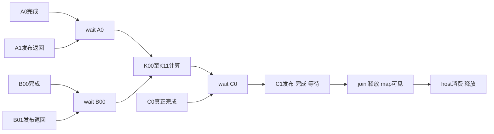

# 控制位置方法设计与完整来源合同验证

2026年10月15日。**A已形成具体输入、算法、判断规则和可执行的源合同检查器；四案八次完整源语义执行通过。完整任务时延预测仍未准入，本轮给出明确的接口与来源重设计条件。** 继续共享IOMMU方法论文主线，原MIG观测保持暂停。

这次推进了合法选择、完整数据和所有权的验证，没有用任意时延填出收益正例。HERO源码支持双缓冲任务和发布前选择，但实际启用copy-based offload，SVM分支关闭；原生共享IOMMU、服务与软件费用尚未绑定。因此八次执行不能记作原四项完整任务时间预测或RTL/FPGA性能通过。

## 最近五天成果怎样进入设计

| 输入 | 实际进入A的规则 | 保留的边界 |
| --- | --- | --- |
| stage117真实cache、consumer与所有权链 | 完成目标含可见性、发布、真正consumer、源复用与目的buffer归还；每个lease有独立退休点 | 交接/发布早于peer结束不等于consumer重叠；258周期不移植到HERO |
| R2准备/提交及完整成本 | 准备结果、物理头移交、W owner、B与上游退休分开；普通方案允许同样的字段/槽复用 | R2/O-B5S的1329+Ccommon逻辑配对结论保持，不把它当新接口总面积或发表覆盖 |
| RCS1集合选择 | 先求真实下一用途和完整任务，而非完整集合数；普通保留/消除冗余工作进入对照 | 原32案只属于带64B额外许可的engine；不恢复该性能主张 |
| AW因果修正 | source handshake、upstream spill、TC input、target spill、shared offer与真正accept分别记账 | 不能用source AW先握手推实际外部AW已被接受；不能强造B2/A0前驱 |
| 早期意图结构窗口 | 信息产生/传递/当前头可见/首次offer分开；只在尚未承诺时有相应动作 | 窗口结构不证明实际共现、传播及时或完整收益；它只是候选输入 |

[28源/42组原文与输入合同](../out/control-position-method-20261015/inputs/recent-contracts.md)、[root直接核读的16组关键原件](../out/control-position-method-20261015/inputs/root-critical-evidence.json)。已有验收复用，未重跑原科学实验、缓存功能检查或已结束ACV-2x2。

## 具体方法

[完整设计](../out/control-position-method-20261015/method/design.md)定义输入为有限任务/生成依赖、容量与owner、既有义务、观察与合法动作、服务与全部费用、完整完成谓词及共同前缀。

分析顺序为：编译并核来源合同；从完整前缀求合法ready；在具体位置施加观察和控制权限；重新生成受影响的PTE/载荷及释放事件；在已绑定服务下探索固定策略的完整结果；输出动作/完成证书与费用。相同观察历史只能使用相同动作，不能拼接事后赢家。有限资源环、缺服务保证和探索未完成均保留失败或UNKNOWN。

| 所需判断 | 方法的准确条件 |
| --- | --- |
| 普通入口优先足够 | 具名普通程序用相同信息和预算满足事前完整目标；只证明两头选择时，结论只到局部动作 |
| 需要更早控制 | 对局部重排，证明所考察owner已承诺而更早可改；对完整目标，必须证明当前位置全部可实现策略都不满足，而已收费更早策略满足 |
| 旧义务使这里无效 | 给出具体不可撤回边和被禁止的动作；若要声称整个任务结果无效，还须证明所有后续合法动作的完成投影相同 |
| 尚缺证据 | 精确列出ready、接口、资源、服务、费用或consumer缺口，不写为零收益或整个思想族失败 |

有完整合法资源顺序及确切持续时间时，用标准最长路/max-plus递推 `finish(v)=max(finish(pred))+duration(v)` 求完成。双方、输出、consumer、release和quiet分别保留。只有源DAG时，这只是因果下界/符号约束；它不证明共享内存服务、容量或时序可达。

当前[检查器](../out/control-position-method-20261015/method/analyze_contract.py)实现源合同结构、ready/前缀、发布保护、B保留、完整consumer闭包和符号约束；协议/cache/有限资源的通用时序探索后端尚未实现。四案的[事前分析输出](../out/control-position-method-20261015/method/predictions.json)均保留完整时延UNKNOWN。

## 来源任务与合法选择

固定HERO提交`c8481a930a15a385d4f58f519bed83d2e75e2a73`的`mm-large.c`，正常输入height32导出width32、stripe16、n=2，六个2048B槽、八笔2048B搬运、四个8192 MAC计算。A0调用返回后，A1未来预取和B00当前输入之间没有跨线程程序依赖，目的a1/b0不别名；未发布时存在不同允许交错。

完整图保留容易漏掉的源程序顺序：K00前A1和B01的发布调用都必须返回，K10前C0和B11的发布调用都必须返回。最终C0等待、C1同步输出、join/free、map可见性、1024元素host compare和host释放全部保留。

该源级选择不证明原API的精确物理可达性或本平台DDR双头共现。统一publisher是显式软件适配，容量预算为两个待发布描述符，载荷仍用原六槽；真实配置/启动、accepted backend容量与job-ID握手尚未绑定。2048B没有当前平台4096B fullbuffer豁免。

源级强普通对照除固定A-first和当前用途优先，还必须允许保留两个原B槽：B只读且n=2时，B10/B11重复同样内容，可删除两次搬运及未创建job的等待。没有新payload容量或免费预填，但要计有效/owner检查、延长持有和软件路径。[完整DAG与适配边界](../out/control-position-method-20261015/cases/reachability.md)／[成本目录](../out/control-position-method-20261015/method/cost-envelope.json)。

## 四案冻结及实际结果

[完整输入和失败判据](../out/control-position-method-20261015/cases/frozen-contract.json)在执行前冻结，SHA为`fe077ddb…772e5b`；两个具名普通程序共享同样静态信息、六槽和publisher预算。每次从host初始化/参考、map和分配走到最终消费释放；不从免费中间状态开始，不调整压力/相位/服务寻找胜例。

| 案例 | 事前预测 | 实际验证 |
| --- | --- | --- |
| P正向源选择 | A0发布后A1/B00均可选；两程序给不同未发布先后，完整矩阵相同 | A-first前缀A0/A1；当前用途优先A0/B00；各8job/16384B，完整consumer通过 |
| N相邻已发布边界 | A0/A1已属于共同前缀，晚程序不能把B00插回A1之前 | 两程序均保留A0/A1前缀；后继仍可有差异，不扩大为全任务控制无效 |
| H1结构留出 | 保留B后B10/B11不是待仲裁的必要任务，不等待不存在job | 两程序各6job/12288B、两个保留检查；完整结果仍相同 |
| H2结构留出 | 从共同初态生成A-first前缀至K11后，不能再把A/B发布当新选择；完整输出/consumer后缀仍必须完成 | 两程序前缀逐事件相同，C1等待、map可见、消费和释放齐全 |

**一次调用共八个完整源语义episode，全部通过；root从1412条原始事件独立复核。** 每案真实执行字节复制、32768个kernel MAC和32768个host-reference MAC，比较全部1024个输出元素；全部A/B源保持，六槽最终释放，所有逻辑job恰一次发布/完成/等待。原任务外部载荷方向为12KiB读/4KiB写，B保留后8KiB读/4KiB写；这不是AXI总线或PTE字节数。

这是一条事前固定的无时序完成序，不是CPU、cache、AXI、RTL或MIG模型。H2线性序中C0在K11处尚未语义完成，只支持后缀义务检查，不是测得的AXI/DDR债务。所有完成周期、CPU/cache时延、AR/R/AW/W/B、面积/Fmax及性能收益保持null。H1/H2为结构留出，不是两项新应用或原时间留出通过。

[实际命令和执行账本](../out/control-position-method-20261015/validation/semantic-execution-ledger.json)／[全部八项原件](../out/control-position-method-20261015/validation/semantic-runs/summary.json)／[root独立事件与数学字节核验](../out/control-position-method-20261015/validation/source-event-verification.json)。代码与输入无结果驱动修订，未重跑成功项。

## 与前作的准确比较和新意论证

TC2023 §2.1允许job内任意请求分布，所以有界PTE依赖可以被其保守总量包络覆盖；不能以“动态到达”否认其适用。其§2.2假设pipeline不满，读写传播独立；§3.7 Algorithm1/Eq.4使用流量、在途、拓扑与服务参数，没有逐owner/first-offer及可控位置输入。MASK §5.4/§6已联合处理翻译与data并生成依赖walk；DWS §V/VI已有owner、非抢占残余与局部交错限制。AXI-ICRT、AXI-REALM已有可选缓冲、组合服务、外置分段及AW/W费用；通用可控状态空间亦是已有工具。

**拟议实质增量**是从共享翻译实际调用/握手与owner抽取可检查部署合同，区分每个位置的合法新动作、不可撤回义务与完整consumer目标，并据此选择最低必要控制或得出无效/未知的准确结论。相同TC粗参数而source/owner不同可以展示新增信息的价值，单独仍不足以证明方法新颖；需要在真实绑定、未参与设计的实例上前瞻预测完整后果及费用。目前已完成合同规则、可执行结构检查和来源语义验证；尚未取得完整时延验证及相对标准分析的充分独立增量，故不把它记为已成立论文主贡献。

[精确页码/章节/行号与原件](../out/control-position-method-20261015/literature/analysis-delta.md)、[独立关键范围审查](../out/control-position-method-20261015/literature/method-scope-review.md)。root接受修正了三个问题：局部不可改不推出完整目标必须更早；source发布不等于所有下游已承诺；H2初始ready与K11切点不混用。原审查快照保留。

## 明确重设计决定

**保留A，推进“真实接口合同抽取＋领域部署判别”；不准入当前HERO版本的共享IOMMU完整时延实验。** 不再把任意有限DAG/状态空间本身主张为独立方法增量，也不把单纯交换发布次序先验写成收益。

最小后继是绑定一条实际启用SVA的任务到可执行publisher：固定任务/构建版本、真实map/attach与target地址、逐lane accepted选项及容量、source发布/TC/target/offer/accept所有权、必要cache/consumer和供给成本。基于原完成API的当前用途优先/未来预取节流可以作为普通程序，不能免费使用translation-complete事件。再将这些输入交给已定义的协议/资源后端，冻结完整正例/相邻反例及两项时间留出；此前不填任意周期、不增加实验矩阵或恢复旧pilot。

DATE2025原件确实评估了启用SVA的DMA workload，作者固定Carfield分支也有实际IOMMU连接；本次取得的源链尚未自动组成HERO任务的绑定。继续核完其已知SDK后，发现固定版本的driver只做物理连续分配/寄存器映射，配置Linux5.10.7，应用目录仅addressability；这不是论文所述Linux6.9 SVA应用链。固定Snitch axpy虽有真实DMA，也不能凭同名替代论文的FP32 SVA双缓冲绑定。原件及准确缺口见[作者实现核查](../out/control-position-method-20261015/cases/enabled-sva-source-gap.md)和[SDK后继核查](../out/control-position-method-20261015/cases/enabled-sva-sdk-followup.md)。**最小后继输入是论文实际实验软件的固定ref及应用—driver—runtime—DMA—consumer链。** 不能把设备树/硬件存在写成应用链已闭合，也不能把HERO关闭的SVM和DATE的kernel-only数字拼起来。

两周窗口仍为10月15—28日，历史用时保留。本轮0时延/RTL/FPGA模型执行、0新板操作、0生产修改、0旧矩阵回放；八次源语义执行单独计账。原MIG goal1792023314的暂停回执与第6次时序失败/0采集、实际债务未知保持。稳定接受与后继要求见[根结果](../out/control-position-method-20261015/root-result-acceptance.json)和[下一合同](../out/control-position-method-20261015/next-decision-contract.json)。
