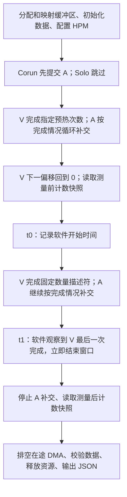

# 实验 v1：访问模式与组会讲解稿

日期：2026-09-08。对应 Linux `affbfbf6adda` 和已构建的 `idma_experiment`。本文按组会叙述顺序组织，可拆成 6～8 页幻灯片。地址序列来自当前代码；参数矩阵是待校准的候选；目前没有 FPGA 实测结果。

## 1. 开场：这轮到底想测什么

可以这样讲：

> 我想研究多个 DMA 共享 IOMMU 时，一个设备的访问是否影响另一个设备。v1 先固定受测设备 Victim 的任务，再加入背景设备 Aggressor，改变 Aggressor 循环访问的页数，比较 Victim 完成同样任务需要多久，并观察两路各自的翻译事件。

Victim（V）是我们关心性能的设备，默认选 DMA0；Aggressor（A）是背景负载，先选 DMA1。名称表示实验角色，不表示已经观察到干扰。当前用可控的内存拷贝微基准，还没有模拟某个真实应用的完整 workload。

这轮首先回答“在这种负载下，共跑是否影响 V，以及影响如何随 A 页工作集变化”。具体是缓存替换、请求阻塞、互连竞争还是 CPU 供给造成，需要后续对照和直接观测。

## 2. Access pattern：DMA 究竟访问什么

### 2.1 每次描述符是一段源到目标的拷贝

CPU 给 DMA 提交源地址、目标地址和长度；DMA 读取源内容并写入目标。一个描述符并不等于一个 AXI 请求，也不等于一次 IOTLB 查询、miss 或 PTW。

v1 当前的模式是 **顺序循环（sequential cyclic）**。每路有独立分配的源、目标缓冲区，源和目标使用相同的缓冲区内偏移；拷贝到末尾后回到开头。数据有区分设备和位置的模式，用于最终正确性检查。

在一段从偏移 0 开始的访问序列中，设每侧页数为 P、每页 4096 字节、每描述符长度为 C：

```text
缓冲区每侧大小 B = P × 4096
第 n 次提交偏移 offset(n) = (n × C) mod B     n 从 0 开始
读地址 = src_iova + offset(n)
写地址 = dst_iova + offset(n)
拷贝长度 = C
```

当前 C 必须是 4096 的正因子且不超过 4096，因此每个描述符不跨 4 KiB 页边界。C=4096 时按页轮换；例如 C=1024 时，先访问页内偏移 0、1024、2048、3072，再到下一页。v1 不是“每次只访问每页开头几个字节”的 page-stride 模式，也没有随机访问选项。

### 2.2 组会主例：V 固定一对页，A 循环 W 对页

E1 候选默认固定 C=4096，V 源/目标各一页，A 源/目标各 W 页。用 W=4 可以画成下面这张表：

| 各路自己的提交序号 n | V：读取 → 写入 | A：读取 → 写入 |
|---:|---|---|
| 0 | V_src[0] → V_dst[0] | A_src[0] → A_dst[0] |
| 1 | V_src[0] → V_dst[0] | A_src[1] → A_dst[1] |
| 2 | V_src[0] → V_dst[0] | A_src[2] → A_dst[2] |
| 3 | V_src[0] → V_dst[0] | A_src[3] → A_dst[3] |
| 4 | V_src[0] → V_dst[0] | A_src[0] → A_dst[0] |
| 5 | V_src[0] → V_dst[0] | A_src[1] → A_dst[1] |

方括号表示缓冲区内页号，表格每格拷贝一整页。这是两路各自的地址序列，**同一行不表示两路同时提交或同时完成**；两路按各自完成情况推进。

V 使用小集合，是希望在 Solo 预热后建立容易复用的翻译状态；是否真的低 miss 要测量。A 改变 W，是改变地址复用距离和潜在翻译工作集，观察共跑影响；W 大并不保证每次 miss。

### 2.3 区分三个经常混淆的量

| 量 | V 的默认值 | 含义 |
|---|---:|---|
| 单个描述符长度 | 4 KiB | 一次 DMA 拷贝多少字节 |
| 被测逻辑拷贝总量 | 4096 × 4 KiB = 16 MiB | 同一对页被反复拷贝，累计完成的工作 |
| 数据页工作集 | 源 4 KiB + 目标 4 KiB = 8 KiB，共 2 页 | 反复访问的不同数据页范围 |

因此组会上应说“V 反复拷贝固定一对页，累计完成 16 MiB”，不能说“V 遍历 16 MiB 工作集”。逻辑拷贝量也不是实际总线流量；源读取、目标写入、页表/其他数据结构访问需分别理解。

A 的每侧大小是 W×4 KiB，两侧共 2W 个映射数据页。例如 W=8 时，两侧共 64 KiB、16 页。加上 V 的 2 页，合计涉及 18 个映射数据页；平台标称 IOTLB 为 16 项，这只是选择该候选点的动机，**不证明实际占用 18 个条目，更不能预设性能拐点**。实际占用/命中受翻译上下文、阶段、条目匹配和替换行为影响。

增大 W 也改变了数据地址范围和复用距离，所以该扫描不能单独隔离“纯翻译开销”。两路有独立缓冲区，不代表其不同翻译上下文下的 IOVA 数值必然不同。

## 3. 一次试验怎么跑，时间从哪里算



主指标为 `T_v = t1 − t0`，输出字段是 `victim_elapsed_ns`。

| 阶段 | 是否计入 T_v | 实际行为 |
|---|---|---|
| 分配、映射、初始化 | 否 | 每次调用重新准备缓冲区和映射 |
| 预热 | 否 | Solo 只预热 V；Corun 时 V 在 A 活动的条件下预热 |
| 测量 | 是 | 包括 V 配置提交、轮询、描述符间补交，以及处理 A 的 CPU 开销 |
| A 尾部排空、最终数据校验 | 否 | V 窗口已经结束，另行记录 drain 时间 |

需要讲清楚的实现细节：

- 一个用户程序、一次运行 ioctl，由一个内核循环管理两路；不是两个独立用户程序或两个 CPU 同时提交。
- 每路最多保持一个“软件已提交、尚未观察完成”的描述符。观察到该路完成才补交下一项；没有“V 和 A 都完成才进入下一轮”的逐 chunk Barrier。
- 循环先检查 V，再检查 A；V 最后一项完成时立即记录 t1，不再补交 A。两路不等速，也不保证精确同时启动。
- 默认预热是 256 个 **V 描述符**，不是两路各完成 256 个，也不是固定时间。A 在这段期间完成多少取决于实际进度，不保证已经遍历自己的全部页；执行预热流程不表示已达到稳定状态。
- 预热结束后，V 的被测序列从偏移 0 开始；A 保持自己的循环进度，可能有跨越 t0 的描述符，不重置到页 0。预热到测量之间没有人为清空 IOTLB，也没有可配置的固定启动间隔；快照期间 CPU 不补交，但已提交 DMA 可能继续前进。
- `warmup=0` 只表示不执行 V 预热，不能据此把硬件状态称为 cold。Corun 即使 warmup=0，也先提交 A。

“A 持续运行”的准确含义是：测量循环持续尝试在 A 完成后补交。它不保证硬件每个周期都有 A 请求，也不证明 A/V 同时在某个共享队列中等待。软件供给是否足够，需要先校准。

HPM 和 active 的两个快照位于 t0 前、t1 后，各寄存器依次读取。它们覆盖的边界与 T_v 不完全相同，可能包含边界外 A 事件；快照耗时单独输出，不能当成原子计数窗口。

## 4. 对照怎么设：固定 V，先只扫 A 的 W

下表是先导试测候选，尚未执行，不是自动生成数据的程序功能。

| 条件 | V | A | 用途 |
|---|---|---|---|
| Solo | 源/目标各 1 页，固定次数 | 不启用 | 同种 V 任务的单路参照 |
| Corun，W=1 | 与 Solo 相同 | 源/目标各 1 页循环 | 加入第二设备的小工作集对照 |
| Corun，W=8 | 与 Solo 相同 | 源/目标各 8 页循环 | 中等工作集候选 |
| Corun，W=32 | 与 Solo 相同 | 源/目标各 32 页循环 | 更大工作集候选 |

保持 chunk=4096、V transfers=4096、V warmup=256、角色和 FPGA 配置不变。A 不设独立固定完成数，它的停止条件跟随 V 窗口，所以实际完成量必须同时记录。这里只固定 A 的访问规则，没有保证不同 W 条件下 A 带宽相同。

板上调用示例：

```sh
# Solo
idma_experiment --device /dev/idma0 --aggressor none \
  --victim-pages 1 --chunk 4096 --transfers 4096 --warmup 256

# Corun，W=8；其他 W 只修改 aggressor-pages
idma_experiment --device /dev/idma0 --aggressor 1 \
  --victim-pages 1 --aggressor-pages 8 \
  --chunk 4096 --transfers 4096 --warmup 256
```

CLI 默认是 Solo，需要显式 `--aggressor 1` 才启用 DMA1。当前程序每调用一次输出一个试次，不自动扫 W、不自动重复/交错试次，也不自动计算 slowdown。

先完成 smoke、事件归属和供给检查，再分别加倍预热长度与 V 测量次数检查敏感性；Solo/Corun 交错重复，根据波动在正式采样前固定次数、顺序和判据。请求压力不足时先修供给或观测，不能把“没有变慢”写成“没有干扰”。

相同 V 任务指同样的页数、地址序列规则、chunk 和次数；不同调用会重新分配/映射，实际 IOVA、物理地址可能变化。当前 JSON 没有导出这些地址和完整翻译上下文标识。需要严格匹配物理地址轨迹或条目身份的后续实验，还需补控制和记录，不能声称 v1 已经保证。

## 5. 拿到 JSON 后怎么解释

| 观测 | 组会上怎么说 | 解释边界 |
|---|---|---|
| `victim_elapsed_ns` | V 完成相同任务的软件观测耗时 | 含 CPU 提交/轮询，不是纯 IOMMU 延迟 |
| V `completed`、`completed_bytes` | 固定的被测 V 工作是否完成 | 成功时应等于输入次数及次数×chunk，预热不计入 |
| A `completed`、`completed_bytes` | V 窗口内软件观察到多少 A 完成 | 描述符可能跨窗口边界，不是精确硬件流量门控 |
| 两路 `iotlb_miss` | 按 DID 分别观察到的 miss 事件数 | 需先端到端校准；不能直接当 miss rate，当前没有 lookup 总数分母 |
| 两路 `s1_ptw`、`s2_ptw` | 对应阶段的 PTW 事件计数 | 不是耗时，也不能直接等同于页表内存读次数 |
| 两路 `active_cycles` | backend 非 idle 的累加周期 | 不是 IOMMU 专属等待，也不能由两路累计值还原重叠时间 |
| A `refill_gap_ns_*` | 观察完成到下一次提交成功的间隙，包含提交 MMIO | 不含硬件完成到被软件发现的延迟，不等于全部硬件空闲时间 |
| `success`、`data_errors`、`quarantined` | 调用是否完整成功，校验/排空是否出错 | success 不表示压力成立、HPM 校准通过或出现机制证据 |

校准通过后，分析时可计算 `slowdown = T_v(Corun) / T_v(Solo)`。例如 **假设** Solo 为 20 ms、Corun 为 25 ms，则为 1.25 倍，即任务时间增加 25%；固定工作量吞吐则为原来的 0.8 倍，下降 20%。这只是算术示例，没有对应板上数据。

正式汇报应同时展示原始时间/分布、V 事件和 A 实际供给量。不要只放一个 slowdown，也不要用一次 Solo 与一次 Corun 的差就宣布稳定效应；失败/超时样本保留原因，不当成正常性能样本。

## 6. 实验逻辑：现象怎样连接到原因

| 实验 | 要回答的问题 | 与 v1 的关系 |
|---|---|---|
| E0 校准 | 时间和计数可信、A 压力足够吗？ | v1 已提供部分软件检查指标；板上校准和硬件压力证据待补 |
| E1 性能 | 共跑时 V 变慢多少，如何随 W 变化？ | 当前最小入口主要支持这一负载 |
| E2 状态 | A 完全排空后，V 的翻译状态是否仍被改变？ | 需要 V 预热→A 有限访问→排空→V 首次探测的独立控制，v1 尚无此模式 |
| E3 阻塞 | A 的 miss/PTW 是否挡住原本可命中的 V 请求？ | 需要到达相位、条目状态和具体等待边界观测，v1 尚无此能力 |
| E4 对照 | 软件供给、普通数据路径等能否解释影响？ | 需匹配地址轨迹/供给等对照；v1 尚未提供 BARE/大页对照入口，持续硬件请求源待补 |

E0～E4 的问题和判据已经提前规划，实施分阶段推进。E1 的结果帮助选择后续参数和投入，但不用于临时发明机制判据；E1 没有可见 slowdown 也不自动取消 E2/E3。

最常见的两种误读：V 变慢且 miss 增加，只说明变慢伴随更多 miss，不能宣布容量替换是唯一原因；V 变慢但 miss 很低，也不能直接宣布 HOL，因为请求可能在 lookup 前等待，或者受软件/数据路径影响。

## 7. 收尾：这次完成到哪里

可以这样讲：

> 目前完成的是实验软件和可构建平台：新入口可以按上述序列生成 Solo/Corun 流量，独立结束 Victim 窗口，记录 per-DID 计数并处理错误。主机控制逻辑测试和完整软件构建通过。下一步在 FPGA 上完成启动、smoke 和 E0 校准，再进行先导测量；当前没有可以汇报为性能结果或 HOL 证据的板上数据。

当前可用 bitstream 为 migration-4dma，DS 延迟配置是 50/50；它用于单独标注的校准试跑。DS 0/0 正式基线尚未构建验收，时钟约束审查也有待办。性能和机制证据以 FPGA 为主线，RTL 仿真按具体观测缺口辅助。

## 8. 一分钟口头版

> 这轮我把 benchmark 改成了一个受控的双 DMA 实验。Victim 反复读固定源页、写固定目标页，每次 4 KiB，累计完成固定的 16 MiB 工作。Aggressor 则在 W 个源页和 W 个目标页之间顺序循环，走完再从头开始。我先保持 Victim 不变，比较 Solo 和不同 W 的 Corun。
>
> 两路由同一个 CPU 循环按完成情况补交，各自推进。预热后开始计时，Victim 完成自己的固定任务就立即停止计时，Aggressor 的尾部排空不算进去。除了 Victim 时间，还记录两路的 miss、PTW 和 Aggressor 的实际完成量、补交间隙。
>
> 这能先观察共跑影响，但不能只靠 slowdown 就证明 HOL。后面已经规划了排空后探测缓存状态、受控请求阻塞和软件/数据路径对照。目前软件已构建，板上校准和正式实验还没有执行。

## 对照代码与其他说明

- 地址分配和逐 4 KiB 映射：`linux/drivers/misc/idma.c` 的 `idma_stream_prepare`、`idma_iommu_map_range`。
- 顺序循环和提交：同文件 `idma_submit`；完成判断：`idma_poll`。
- 每路独立补交、V 优先结束：`idma_run_window`。
- 预热、V 偏移复位、快照、排空和校验：`idma_run_experiment`。
- 默认参数、每次调用的一行 JSON：`bench/idma_experiment.c`。
- 完整使用/字段定义：[实验入口 v1](experiment-v1.md)；科学判据：[实验总设计](history/plans/experiment-plan.md)；候选负载：[双路设计](experiment-design-v1.md)；构建证据：[验证记录](validation.md)。

本说明只补充讲解和实现对照，没有修改驱动、RTL 或实验参数，也未重新构建或产生实验数据。
