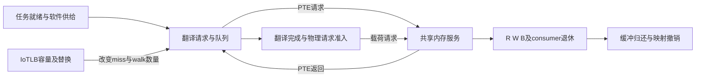

# 共享页表服务控制边界与研究推进裁决

**结论：现有生成MIG参考的控制边界已经明确，旧板端记录却不能证明目标PTE遇到多少前序载荷读债务。完成一次有界裁决，停在一条被动因果记录的合同，不准入新机制原型或性能条件。** 普通入口优先能改变尚未承诺请求的顺序，不能把MIG已经接受的载荷读撤销或移到后来PTE之后。

本轮落实用户2026年10月15日批准的研究推进审查。LR1实际goal1791990424保持complete；本轮没有登记、重开或更新goal。IOMMU方法论文主线和原立题窗口保留，论文未完成。[完整产物](../out/shared-service-control-boundary-20261015/README.md)提供规则、来源、费用、勘误、接受记录及唯一后继合同。

## 问题地图与已有结论

E1/E4把供给、实际执行和完成发现分开，硬件batch建立真实重叠；这是评价基础，不是其他节点的完整归因。各阶段计数可能重叠，不能相加，也不能把局部提前当成双方完整收益。

| 问题 | 已有证据和范围 | 普通已解决部分 | 仍未证实的缺口 |
| --- | --- | --- | --- |
| 容量替换 | E2实板有限布局：A先排空，V首次再用2miss；W7/W8探测中位696/1483周期。 | 固定分区、局部替换历史隔离保护具名驻留；部分短窗口Hpin足够。 | 动态真实任务中保护驻留必须牺牲哪项有用进度；没有新评分必要性证明。 |
| 翻译等待传播 | E3受控64B：A服务及V等待同步增加127/129/129/130周期，随后V首次hit。 | NativeN提供异bank限定hit旁路，通用非阻塞须作为普通能力。 | 完整源身份路由、合法返回预约和owner控制后，剩余的不可避免链。 |
| 页表与数据服务竞争 | 行为DDR中PN提前数据AR使PTE的AR到R握手为334周期，P为45。实板隔离后约12.7%退化是另一份尚未闭合因果的事实。 | M0的DS返回优先使P/PN的V均76738、A均76164，旧3689周期差额已解决。 | 旧正常工作中实际MIG接受PTE时的前序载荷债务，以及可部署普通程序作用在哪段等待。 |
| 请求执行限制 | bank生命周期、head-only、held VALID、AW/W owner是源码事实。fullbuffer严格要求正常对齐4096B，64B不豁免。 | 原位准备、字段复用、完整预约、full-source非阻塞与owner普通程序表达多项动作。 | 接口、状态组织、端口和选择延迟的实际成本增量，而不是源码缺项本身。 |
| 所有权与映射生命周期 | LR1私有参考验证完整R及旧义务闭合后覆写源页不污染旧目的；最终R在W/B前是源码偏序。 | 同付费收据、封口和同步能力上的普通阶段程序满足冻结合同。 | 实际提前撤权需求；IOMMU闭合、晚fill、失效和排序是否有实付优势；ACK后净窗口未知。 |

原始导航：[E2](../out/e2-results-review-20261003/RESULTS.md)、[E3](e3-controlled-results-review.md)、[PN原事件](../out/pn-data-path-20261007/pn-full-events.csv)、[M0](workflow-g0-m0-results-20261010.md)、[历史板端边界](composition-history-isolation-20261007.md)、[LR1](local-read-reclaim-20261015.md)。[机器可读地图](../out/shared-service-control-boundary-20261015/root/problem-map.json)逐项标明board、源码、条件模型、推断与假设，不以同miss数推出同地址或同服务链。

## 关闭结论积累及强对照分类

| 候选 | 关闭的具体主张 | 保留的边界 |
| --- | --- | --- |
| R2 | O-B5S同预算复用union cell、早退头槽、保持原序AW/W；普通不必另存prepared副本或把raw cell留到B。 | 限定成功/TL fault生命周期成立，非所有remap/reset/cancel及整任务错误活性。 |
| CO1 | 读卡后构造的OC1-min证明TTL、结构rank不是本规则必需；同阶段接口上控制等价。 | 任务登记、精确最后用途和集成架构不是由此证明已发表或已部署。 |
| RCS1 | 固定SJF在四条件完整完成不差于RCS；完整集合数量不是收益充分代理。 | 原32项是带额外64B许可的条件engine负结果；真实guard更正后没有新的native性能。 |
| BR1 | 固定DAG、单受影响节点、资源次序不变时StaticCP精确覆盖；新短图有简单零影响victim。 | victim改变后续PTE/data到达与驻留的动态族未被定理覆盖，也没有完整收益见证。 |
| SDH1 | 当前W与源内最老条件唯一确定请求；共同direct-OUT架构上的选择与O-NBO相同。 | 同bank完整源路由不是原生N已有能力；hit-under-miss概念前史不等于完整协议覆盖。 |
| LR1 | 同付费phase/closure执行器上的phased/targeted复现冻结控制和参考值。 | 接口产生、原生实现成本和真实净收益未验；多别名成功范围需收窄。 |

准确发表前作、独立普通构造、候选等价实现及离线上界必须分别记录。独立编码不等于设计来源独立；具体等价程序可以剥离策略增量和冗余状态，不能独自证明完整接口已发表。不同条件的事后赢家也不能拼成在线对照。

以“已有接口＋普通规则”“新增付费接口＋普通规则”“新增接口＋候选规则”区分接口与策略贡献。后两者相等只排除接口之上的策略增量；任何接口增量仍须有实际需求、准确前作和完整实现成本。候选也无需击败所有可想象程序。[逐候选范围](../out/shared-service-control-boundary-20261015/root/candidate-scope-review.json)与[普通对象分类](../out/shared-service-control-boundary-20261015/controls/control-classification.json)保存来源。

## 已生成参考与板端记录的连接

上次审查遗漏了已经完成的[DDR服务边界](ddr-service-boundary-20261014.md)。这项2026年10月14日成果直接继承：实际生成参考为MIG4.2、AXI64/fullID6、内部64到256 upsizer、NORM及RD_PRI_REG；不能只依据工程XML的4.1标签。AR-first改变未来offer，ARQOS在该分支只影响读写切换，没有read-vs-read提升；已接受读按顺序返回，held R保持原字段。

本轮新增来源连接的限定是：旧参考绑定work-fpga BIT `f15f8a72…`，历史板验收使用route-opt BIT `f9fa9434…`。保存的result和Vivado日志记录同一routed DCP经后处理生成后者；载入回执为成功，代表isolated和PN短段记录共享boot。两个BIT字节不同，不据此判功能不同。Mac载入路径没有保存SHA，因此不声称旧参考就是板端相同字节，更不推断当前加载、板连接或时钟身份。[原件及SHA](../out/shared-service-control-boundary-20261015/native/evidence.json)保留具体链。

旧V9参考有35个主计数和P4M窗口，但主magic未在代表原record独立保存。决定源码表明：shared AR/AW tap接的是IOMMU tr入口；sharedAWwait只是该处VALID且未READY。private stock按AR及RLAST每burst增减，不是剩余beat；mode3/legacy0又关闭旧E3/PTW历史。翻译、atomics和异步CDC后的MIG ARLEN、逐R拍及PTE owner并未被这些汇总记录。

因此不能由等miss数、总AWwait或private stock回推出PTE接受时的债务。问题从“还缺MIG分析”收敛为一个明确缺测：[原生判断与观测合同](../out/shared-service-control-boundary-20261015/native/observation.md)。这不恢复旧3689周期收益，也不把结构条件当成实板12.7%的归因。

| 阶段 | 行为DDR旧事件 | 真实参考及板端边界 |
| --- | --- | --- |
| PTE产生／共享首次VALID | 不能从旧`ddr_ar`握手事件反推。 | 普通只见其真实selector拥有的current-VALID头；旧板没有对应事件链。 |
| PTE AR接受 | P为2763、PN为2766；PN数据AR在2763。 | 必须在MIG接受端记录，不能以TC内部交接或pre-CDC接受代替。 |
| 前序载荷R | PN首R握手2813，最后R握手3068。 | 已接受载荷是不可免费取消的公用债务；旧板无逐拍记录。 |
| PTE首次RVALID／held | 未记录；旧`ddr_r_first`实际是握手。 | held与无RVALID必须分别观察。 |
| PTE R握手／walker消费 | P为2808／2864，PN为3100／3156。 | MIG事件使用ui clock，source消费使用平台clock，不能直接相减。 |
| 完整任务后果 | M0条件模型已有普通解决结果。 | 本轮无原生反事实完成向量、费用或新收益。 |

[三域因果表](../out/shared-service-control-boundary-20261015/root/causal-chain.json)分开旧行为事件、生成源条件定理和板端未知，未重解析或回放旧trace。

## 固定普通程序及全部成本

可构造的普通入口规则固定在共享xbar的DDR mux AR选择器：首次offer前优先current-VALID的DS，否则非DS RR；持续竞争时四次DS接受后让非DS逃逸。held头保持到真正交接，已有spill、atomics、CDC和MIG义务继续drain，不修改AW/W/B/R所有权，不读取未来PTE或隐藏DDR状态。

实际编译选择的是CVA6 vendor的`axi_mux`与`rr_arb_tree`，由生成`add_sources.tcl`绑定；另一IOMMU vendor副本不能代证。source0/1/2/3分别为CPU/debug/completion/DS。DS是已有聚合端口的当前读头，包含PTW/DDTW/CQ等，不是预测未来PTE。[完整可综合设计合同](../out/shared-service-control-boundary-20261015/controls/ordinary-program.md)给出真实层次、接口、held、公平及同ID证明；它是本轮构造的设计，尚未生产实现、编译或时序验收。

该普通程序的一个可选绝对selector编码为8bit，不是总新增bits或面积。必须计入替换旧选择状态、完整AR多路选择及READY扇出、优先／公平逻辑、静态参数传递、已有storage/debt、观察和owner关联，以及软件和全部任务完成。总增量state、选择周期、面积、Fmax、CPU和应用收益为null。[成本目录](../out/shared-service-control-boundary-20261015/controls/cost.json)给出可数编码与未知项。

强普通允许现有合法deburst、带完整parent语义的分段、提前准备和公开QoS，但分别收费。原deburst是读写都拆单拍，不是现成任意读长度旋钮；两段256beat变512个单拍时AR/AW/B增加不能忽略。原source QoS为0，属性注入需要明确位置；此MIG的非零QoS也不提供已接受read提升。前两DMA buffer512、后两3和原fullbuffer资格保持。

接口能力、控制合法性、成本优势和实际收益分别裁决。M0的`mem_q.rotate`属于内存服务者中的条件返回law，不能以普通程序的名称免费塞进真实MIG。反之，若将来确有付费新接口，它与普通策略同动作也不自动否定接口贡献。

## 唯一观测合同与停止条件

冻结原合法A8/gap0 PN短段参数：V64、warmup256、原正常COPY，首个合格PTE的选择不依赖债务是否为正。本轮仅写合同，未运行该条件；它不是完整固定双方工作量的性能实验。已知quiet前开始连续追踪，保留原窗口carry-in和完整机会计数，不通过相位、延迟或额外任务寻找正例。

最少原始事实是：**PTE P在实际MIG AR接受边沿，前序payload还欠多少R拍，以及该债务到P第一次RVALID/握手的消解。** 对每个更早接受的payload occurrence j，`k_j=ARLEN_j+1−截至并包括该边沿的关联R握手数`；先扣同沿Rfire，再快照，P本身不计前序。

记录MIG fullID/地址/LEN/SIZE/BURST及接受序号、逐R握手/RESP/LAST、首次VALID与held区段；关联真实PTW owner和DMA descriptor/burst occurrence。fullID会复用，必须有epoch及每RID occurrence，不能凭DID或端口前缀猜job。CPU、DDTW及其他前序义务分别分类。MIG顺序只用ui clock；CDC两侧timestamp不直接相减。错误、丢失、溢出、回绕、reset/calibration切换、长度不守恒或owner不唯一使记录无效。未实施的tracker、记录存储、字段传播、CDC观测和软件读取费用同样保留，不给免费接口。

| 结果 | 可接受的结论及后续 |
| --- | --- |
| 有效记录中`k>0`，前序载荷消解后P才能返回 | 接受该正常片段遇到已承诺载荷债务；下一步才比较一个真实可控制机会与固定普通程序，不据此宣布完整归因或创新。 |
| 该片段`k=0`或P先接受 | 只否定该片段的前序债务解释；不否定整个工作或问题族，不自动换相位补例。 |
| 无合格PTE／采集无效 | 用完整窗口机会计数和无记录原因区分无PTE、未捕获及错误；保持unknown，不能写成零等待。 |
| 可部署普通动作已满足同任务需求 | 结束这项具名残余问题，把普通解决边界写入地图；不再换评分或重命名同类候选。 |
| 新执行动作／信息组织有实付增量且净完整收益可检验 | 另冻结一个有界机制合同，再最多四条件、一个GPU/AI实际共享路径和FPGA关键验证。 |

本轮不前置旧F1的“两安全NormalTL队头”作为通用门。将来是否需要两个队头取决于具体动作；当前观测只检验正常工作中的真实债务。共同选择之前已经接受的L不能作为候选免费消除的收益。没有这一个新增事实，不再延长重复源码轮次或更换返回模型。[下一合同](../out/shared-service-control-boundary-20261015/next-decision-contract.json)冻结本轮止步和后继边界。

## 勘误与交付

LR1三项限定已明确留存：Intel旧摘录的逻辑行号混用了LF物理行号，TC内部移交不能冒外部物理AR接受，跨context/IOVA PA别名成功范围不能扩大。正确原文仍支持定向drain前史；所有旧raw产物和完成回执不改写。[原件副本、具体诊断及修正](../out/shared-service-control-boundary-20261015/errata/corrections.md)与[稳定根裁决](../out/shared-service-control-boundary-20261015/root-result-acceptance.json)给出影响范围。

执行为Codex-only，root负责机制边界与接受，两个新6.1-sol/ultra/fork-none席分别核原生来源／观测和普通构造／成本。使用原生上下文默认值，不改配置。0新goal、0实验／原型／旧validator或trace回放／构建／板操作／生产RTL-driver-ABI，未恢复旧席或关闭分支，未增加压力、队列容量或walker。五份公共状态与计划同步，旧六页逐字归档；本轮只运行新交付的引用、语义和完整性核验，其结果不当性能证据。
