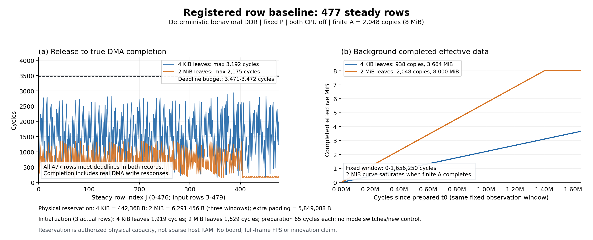

# 行预取 G0 结果与本轮立题裁决

2026-10-11 发起，2026-10-12（Asia/Tokyo）收束；文件名沿用已冻结批次标识。由 Codex root 实质设计、核源、编译与执行，三个新增席配置 gpt-6.1-sol／ultra。本轮未调用 DeepSeek 或 Claude。

**本轮不进入新机制原型。** 行预取的普通固定分区已经满足登记期限，关闭“为满足这项期限需要新增保护”的假设；双缓冲流处理因缺实际计算和槽位释放合同而延后。共享翻译主线保留，两个判断均不表示整个问题域没有方法空间。[根裁决](../out/research-execution-20261011/root-result-acceptance.json)

## 1. 实际执行与冻结条件

复用现有 SYSTEM 的实际 iDMA、IOMMU 和互连模块及已编译模型；只编译一个私有 C++ 工作流驱动。原 C++ 的私有副本只补一个 rising edge 前观察入口，生产 RTL、ABI、Linux 和原验收测试源码均未修改。模型的93项项目输入元数据匹配，运行前后109项源／产物哈希无变化；当前哈希不是旧构建时的追溯签名，现安装的 Verilator 工具元数据与旧模型构建不同。本次没有重新展开 Verilator。[接口与来源](../out/research-execution-20261011/workflow-interface-review.json)、[运行后源保护](../out/research-execution-20261011/post-run-source-guard.json)

DASH §2.2 支持640×480、30fps、四行槽及每行约69.44μs。模型按50MHz换算为31250/9周期；这是源需求对应的建模单位，不是本次新验收了FPGA时钟。前3行实际初始化，稳态row3..479共477笔，每笔640B。第j项释放为ceil(j×31250/9)，期限为floor((j+1)×31250/9)，绝不按issue/done移动释放。当前只观察预取可消费条件，没有执行Sobel计算或验证整帧FPS。

后台是本研究追加的独立DID11、源目的各16页环、2048笔4KiB COPY，共8MiB；它不是DASH原例的实测后台应用。gap0且双方自然结束，无STOP A。两项比较均为固定P、CPU测试源关闭、静态S1、无S2、无N、无逐copy新门控、无DS优先；行为DDR按旧head-serial规则，delay31适用于所有读请求，不是独立PTW延迟或MIG模型。[运行前登记](../out/research-execution-20261011/row-baseline-register.json)、[需求卡](workflow-row-prefilter-20261011.md)

所有载荷物理地址、数据及任务完全一致。V目的移至0x80200000，避免旧微基准目的0x80001000落入307200B源帧；A两环在独立上下文。4KiB与2MiB只改变合法映射，2MiB扩大的授权范围单列成本。没有按结果修改期限、负载或再搜有利压力。

## 2. 结果

每种配置只运行一次确定性模型。共同观察窗为各自配置准备完成的t0至1,656,250周期；后台进度仅计实际完成的COPY有效字节，未完成的写入不算完成进度。t0之前成本在下一节单列。

| 指标 | P＋4KiB | P＋2MiB |
|---|---:|---:|
| 稳态行迟到／总数 | 0／477 | 0／477 |
| 最慢行释放至真实完成（周期） | 3192 | 2175 |
| 最小期限余量（周期） | 280 | 1297 |
| 窗口内后台完成COPY | 938 | 2048 |
| 窗口内后台完成有效字节 | 3,842,048（3.664MiB） | 8,388,608（8MiB） |
| V最后稳态完成（周期） | 1,654,760 | 1,652,966 |
| A全部完成（周期） | 3,309,615 | 1,401,779 |
| 最终quiet／T_return（周期） | 3,309,632 | 1,656,267 |

2MiB的有限后台在观察窗结束前完成，图中随后饱和；后段行延迟变低也包含A已结束的效果。因此不能把两条曲线全部差异当作同一时刻相同竞争强度下的改进，或据此宣称无限流吞吐比。两项都完整报告尾段与排空，不隐藏4KiB的后台剩余工作。

[可导出PDF](../out/research-execution-20261011/row-baseline-results.pdf)／[逐任务4KiB记录](../out/research-execution-20261011/row-p-4k.json)／[逐任务2MiB记录](../out/research-execution-20261011/row-p-2m.json)。图由标准绘图工具生成，未重新运行模型。

## 3. 成本与正确性

| 成本 | P＋4KiB | P＋2MiB |
|---|---:|---:|
| 最低映射／保留物理容量 | 442,368B（432KiB） | 6,291,456B（三个2MiB窗口） |
| 相对4KiB额外容量 | 0 | 5,849,088B |
| 前3行实际初始化（周期） | 1919 | 1629 |
| 初始化后公共配置准备（周期） | 65 | 65 |
| 新控制／运行时切模式 | 0／0 | 0／0 |

容量指合法授权和连续保留范围，不是稀疏内存模型的宿主RAM用量或FPGA面积。准备时钟从init_start计；此前模型复位22周期另在绝对时间可见。页表／宿主内存构造不在该时钟区间，真实CPU软件执行、页分配、IOMMU映射、缓存与FPGA资源／时序成本均未测。固定P是既有能力，“无新控制”不表示既有分区硬件没有成本。2MiB只是强简单映射邻例，不能称同物理容量预算的免费替代。[成本表](../out/research-execution-20261011/row-cost-table.json)

两项运行各有480笔V和2048笔A的硬件ISSUE/DONE；V请求／返回／实际W各307200B，A各8388608B，V的AW/B为690／690，A为4096／4096。每笔在真实done后核数据，最终核源不变和目的保护区；逐周期核CPU关闭、协议及地址归属。

独立校验器从CSV重建固定释放／期限、issue／firstW／done、AR/AW精确地址覆盖、accepted R_LAST与W_LAST字节、B队列和最终quiet，逐项匹配JSON。七项内存篡改负测均拒绝，原始文件未修改。独立范围是burst与任务级；每拍数据、VALID稳定及源／保护区内容仍由实际驱动检查承担，不声称独立重放了每拍数据。[4KiB验收](../out/research-execution-20261011/row-p-4k-independent-verification.json)、[2MiB验收](../out/research-execution-20261011/row-p-2m-independent-verification.json)

## 4. 立题与下一关口

A：归档已登记的期限失效假设。4KiB普通P自身就完成全部477期限，无需靠大页来救这项要求。不能据此证明后台全局最优、硬实时或其他压力／应用无空间。已有大页改善后台的结果及容量代价作为基线资产保留，不包装成新方法。

B：保持证据未决。原文支持输入／计算／输出双缓冲，但没有可移植的固定kernel、块大小、计算及slot-release轨迹；强度扫描也不是同次应用的自然阶段。本轮B未运行模型，不能将它列为实验阴性。[B需求与最小缺证](workflow-stream-prefilter-20261011.md)

本轮按计划提前结束，不进入G1新规则、G2留出或FPGA原型。新门控、反馈改造、消融、板测只有在一个真实需求下具体未覆盖损失获支持后才执行；没有候选时不以更多测试或新压力值填满十天。

重开条件是新的来源明确需求或可核实执行事实：例如同一合法工作流下普通方法确有可改善损失，并有相应独立强对照；B则先补一份固定应用合同、可重建事件段和真实缓冲／DMA预算。不从调整本例期限来制造正例，不自动恢复旧p5、PN或晚选目的。

本轮新增执行：私有C++编译1次、登记DMA模型进程2次、离线核验2案（核验器4进程，7种损坏自检运行2轮均拒绝）、绘图1次；旧矩阵重跑、生产修改、FPGA构建与上板均为0。[执行账本](../out/research-execution-20261011/execution-ledger.json)／[整体路线](../../研究计划.md)／[具体计划](research-execution-plan-20261011.md)
