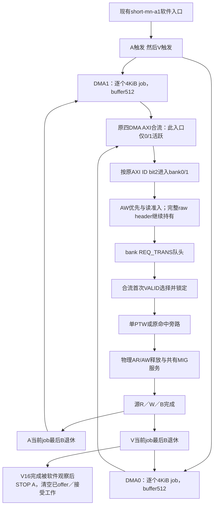

# 同一来源的可达性与选择差异卡（2026-10-14）

本轮实际goal1791943603，无额外token预算，执行用户批准的合并关口。只读一个既有来源，不运行旧composition实验或新A/B。**关闭的是：用该入口的512/3异构缓冲作为正例，以及直接把原V窗口当成固定双方完整任务收益。F1全族保留，真实首次共同可选状态及独有选择差异仍unknown，本入口不准入A/B。**

## 唯一来源与已有事实

来源固定为原计划的`short-mn-a1`：N=1、A pages1、V pages1、gap0、transfers16、warmup16。它是原short第6项/首个N双源条件；没有运行或依据旧结果挑样。软件是当前`bench/idma_composition.c`→composition ioctl→`linux/drivers/misc/idma.c`，硬件只引用上轮已绑定的Genesys2 composition源码目录。当前软件字节尚未绑定旧Linux Image/tool binary，当前live FPGA也未核；软件合同及钉住RTL推导不冒称板测。

软件只启动DMA0/DID10与DMA1/DID11。该硬件nonblock配置下两者同为512拍，未由本入口启动的DMA2/3才为3拍。打开2/3或加入新负载以制造异构双头，超出本轮来源且违反不增加并发条件。此事实排除当前入口的异构缓冲正例，不排除平台上所有其他正常来源。

## 来源—所有权—依赖图

图中循环各属于原source自身；箭头不表示A/V同边沿、固定AR先后或一笔数据在两个source间转移。原ID局部0经四DMA合流成为0/4，BankIdBit=2；同DDR source2前缀后为32/36。PTW48/DDTW49的历史DDR合同保留，不新推导bit/live等价。

## 合法事件链：已证明的边与未知的时间

1. mode/config及clear先于映射/初始化/CPU flush/warmup；V完成16个warmup，A次数由调度决定并随后drain。测量batch重设双方首offset0、pages1/gap0，触发顺序为A NEXT_ID读→V NEXT_ID读。**CPU触发顺序不证明job accept、首AR/AW或MIG接受先后。**
2. frontend COUNT的job VALID保持至job FIFO接受，然后进入WAIT；只有当前copy最后B对应的backend完成，才回COUNT生成下一job。JobFIFO深度8、AXI在途8是容量，不能当8个已接受copy。证书仅在已接受DEFAULT/对齐4KiB/容量≥4096且无重叠故障时给本job许可；不能把页数1等同永远可读。
3. raw AR/AW所有权仍在原header/FIFO中。bank IDLE先选AW；AR必须满足read_admit或匹配DID10+b的有效fullbuffer证书。input W owner及signed未填余额、新AW同沿排除原样保留；不能从同bank第二个raw头再挑任务。
4. REQ_TRANS经过BC后给出bank VALID。合流RR位于TL normal_gate之前，`LockIn=1`在首次VALID而READY=0时保存请求mask和决定。因此“TL仍忙时后来两bank都VALID”不等于两者首次VALID前仍可选。另一头后来出现，不能覆盖已有offer。
5. 定义唯一合法F1快照谓词：`D = H0合法且VALID ∧ H1合法且VALID ∧ 无旧merged offer锁 ∧ 快照在首次merged VALID之前`。D不要求TL READY已为1；READY=0只会令本次选择随后held，不能给它第二次选择机会。源代码提供该合法域，但目前没有同一正常接受前缀证明本exactcase实际到达D；不以任意寄存器初态或插入等待构造D。
6. NormalTL接受后保留bank owner，一个PTW完整walk，另一bank只保留原hit旁路许可。翻译完成只是允许physical AR/AW，完整source R、physical/error W、B及最终quiet仍各自欠账。下一个job在最后B之后产生；不能把TL响应当job退休。

mode/config的clear只由合法offset2写产生，arm/open/close不会直接产生该clear。warmup后当前软件无显式IoTLB/DDTC invalidation。**仍不宣称测量全hit或无PTE**：最终cache状态、外部invalidation/上下文、PTE阶段及首次D快照没有原始时间证据；16项容量大于四个映射页本身也不是完整替换与所有事件证明。不为改变这些状态补warmup、清cache或扫启动相位。

## 已接受共同债务与首选差异

在快照时已经MIG接受的数据L对A→B/B→A都不可撤销；这笔共有债务必须在两轨迹中逐项相同。只有某个首选释放的、已经拥有且能精确关联的义务进入同一后继PTE之前，才能形成选择产生的反馈。PTE的owner/context/stage/level须相同；把walk晚启动、不同PTE消失或cache hit替代walk当成同PTE等待差不成立。

候选F1规则保留：只比较两个合法队头；用已拥有义务和已完成PTE/service历史联合预测两个顺序，按当前义务max完成、sum完成、年龄/RR选择，缺历史回退RR，一次越过后保留对方下一次许可。没有新历史端口实现或真实D快照，不生成两个分数或假收益。

| 具体状态 | F1／普通规则裁决 |
|---|---|
| 一个合法头或原merged VALID已held | 按共同合同只能服务该头／原winner；RR及所有合法对照同样不能重新选。仅说明选择覆盖，不宣称完整费用/周期相等。 |
| D成立，但必要历史无效 | F1明确回退同一native RR；O-RR复现本次选择。新增选择延迟造成的时序变化不能当独有预测排序收益。 |
| D与有效历史同时成立 | 本入口实际快照未证明；candidate分数、owner/short/debt对照差异及完整收益unknown。没有证据把O-owner或O-debt宣布为全族覆盖。 |
| 企图借活跃512/3不同缓冲得到差异 | 本入口两活跃source均512，前提不成立；该实例关闭。 |

九冻结完整在线合同继续有效：RR、年龄、owner、short-TL、debt-min、debt-max、release-density、turn、two-stage。所有规则使用同一付费信息；不逐场景拼最佳。owner必须由真实释放依赖关联，bank相同不够。O-turn旧统一turn定理不移植真实DDR；O-two-stage的独立固定两机前提未成立，不能用Johnson全面否决共享反馈。已有MASK/ISCA2018原文边界不扩大。

## 原窗口为何不能直接证明双方完整收益

V测量target固定16；A target为`2^32`，不是预先固定的16次。driver在观察V完成后才STOP A、drain、收集issued/completed与数据校验。STOP不能撤回已offer job/AXI：COUNT保持VALID，WAIT当前job完成后才停。

因此两策略可有不同A接受数`nA_AB`与`nA_BA`；软件观察/STOP时延也是真成本。正常copy逻辑字节为`B_V=16*4096=65536`，`B_A=nA*4096`；payload R+W字节分别为两倍，warmup/启动/尾部及PTE另计。这是**源码条件式，不是新实际字节测量**。不能把A target2^32计为已拥有工作，也不能把nA默认为16或忽略A尾部。

原窗口适合其既有V窗口/背景A合同，不能直接用于本轮“相同工作量、双方完整完成”的A/B主张。本轮不改A target、STOP触发、job数量、warmup、容量或背景压力来补这个门。若未来只比较一对当前job，也必须保留期间新A job的原生接受与服务，不能免费暂停背景或删新债务。

## 可观察输入、所有权与完整成本

原118bit NormalTL请求、185bit响应、raw/physical AR/AW、fullID、同ID顺序、input/output W owner、Rspill/B/错误及原credit全继承。NormalTL头没有LEN/SIZE、copy序号或全部退休关系。重复job使用同一source ID，不能只凭RID/DID或重复的数据pattern归属某个A/B head。

必要新增观察为：两head合法/ready及**此前merged offer**状态，source/job接受序号与raw header关联，当前R/W/B余额和退休事件，active slow-walk owner/PTE完成记录、历史class/valid/overflow，DDR侧顺序与跨clock一致snapshot。不能把已有host日志、aggregate window计数或内部MIG队列当免费在线输入。

复用[37分类成本接口](../../tl-memory-feedback-20261014/ordinary-cost/cost-interface-card.md)：所有未能合法复用的计数/tag/timestamp、事件CDC、读写端口、多事件更新/匹配、age/fair、历史生成字节与时间、两顺序虚拟状态和max/sum算术、选择mux/延迟/时序及CPU STOP/drain均计费。native RR不强加无用历史；预测不能借真实payload槽提高可用容量。完整实现宽度/端口/延迟/面积/Fmax/CPU/应用均未测，保持null，不借R2旧整数冒充新成本。

## 稳定停止与后继

本轮来源与因果确实在同一关核查；获得了活跃source、solejob、offer锁和可变A工作量的决定边界。**本入口不准入A/B，也不交付假可执行A/B合同。** 无任何新实验、旧回放、生产修改或板操作。

若要再进入F1，输入必须一次性包含同一正常来源的“首次VALID前真实双头、已拥有释放依赖、固定可比较完整工作量”证据包，并给一个适用冻结普通规则外的具体差异。没有这一包，不再自动开启同类source/边界审查，不修改本entry制造它。若另提出承诺更晚的调度点或有限A作业来源，需要独立新机制/来源合同；本轮不自动切换。F1全族、论文主问题及8/9月资产保留，所有关闭分支仍关闭。
