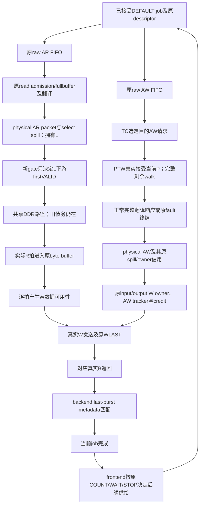

# PTE准入的完整R/W/B裁决卡（2026-10-14）

**稳定停止：完整流式写入已纳入依赖与手推；它能改变R-only选择，但本轮条件正反方向未绑定实际共享DDR服务和正常接受前缀，不准入microbenchmark。** 一个具体闭式W包络实现覆盖本手算candidate的选择，不能把两份完整预测rollout作为这对条件的独有能力。完整physical-AR准入家族与F1全族仍open，全部停止入口/关闭分支保持。

实际goal1791949728，无额外token预算，半工作日界限；root独自Sol6.1/ultra/native，0新增席。只执行来源/机制/完整成本与交付，不做模型、bench、仿真、build、旧validator/trace回放、RTL/板或压力修改。论文未完成。

## 具体问题、已有证据和关口

已有physical payload gate合法性、PTE真实DS输入接受/同P共享AR出口接受、held和原容量合同继承，不重核52拍准备或旧硬件绑定。本轮问：立即放行原合法已拥有L，或等当前已接受P的共享出口接受后重新评估，加入真实R/W streaming、W owner、B/job/quiet和全部成本，是否还出现普通规则外的完整max/sum差异？

上轮PTE保护/fit-gap独立贡献已经被普通规则覆盖。R-only式min(a,h)<=g仅为条件手算，不是当前copy正例。本轮先冻结currentDS+RR、earlyPause、owner、cheapDebt、dualGap五条完整在线规则，再手推新完整终点；不按新结果修改它们或逐场景拼赢家。dualGap的h要从同一R-service端点覆盖DS返回、PTW消费、remaining walk及真实dependent payload，root做了端点澄清，阈值不变。

进入性能门需要同一正常来源的accepted snapshot、固定完整工作量、当前合法pre-firstVALID、已拥有完整释放依赖、有效付费历史、共享服务反事实与普通外差异。结束条件为正例/相邻反例或具体覆盖/来源未成立理由的稳定裁决；交付、五文档与必要新核验先完成，才actualcomplete。

## 来源与完整所有权依赖图

参考仅是既有composition staged RTL与原正常DEFAULT copy协议，不另选来源/板或执行停止的short-mn-a1。实际活跃source0/1各buffer512、one-dimensional frontend、jobFIFO8/AX-inflight8、onePTW/IoTLB16不变。源码与原文SHA见source-snapshot.json/source-excerpts.md。

图中箭头是依赖，不是强制先完成全部R才开始W。正常PTE响应被消费后才检查leaf/权限，非叶继续MEM_ACCESS，fault走原错误路径；当前P共享AR接受或R返回均不能当全部walk完成。N fast-hit与slow owner分开，主req_data直到正常/debug/ATS响应握手才释放；原request.bank是slow owner，不能把fast候选覆盖它。

## 新原始事实：gate前已有物理AR所有权迁移

TC目标demux两个分支都SpillAr=1；axi_demux把完整physical AR与目标select分别放在现有非旁路spill，slv.ARREADY是两者空间许可。随后bank output mux SpillAr=0，top直接连接completion出口。故可能发生：TC COMPLETE的AR被原demux spill接受，TC回IDLE；L尚在这个spill/外侧mux、还没有穿过新gate，而TC当前头已改变。

因此L的身份与生命周期必须从**存活physical packet/select与原job/owner**读；不能从TC当前trans_req_data重建它，也不能仅凭output mux没有spill断言“L所在bank还在COMPLETE，所以P必在另bank”。是否某个正常4KiB来源实际达到同bank/不同bank情形仍需原始前缀，本轮不虚构初态。原spill已拥有L，保持其完整header；新gate不额外复制它或提供新槽。

在one accepted job per actual DMA的有限域，若full source-ID/原active-job lifetime可直接关联当前job，可以复用仍活跃字段，不强制新增通用job-tag。但AR/R/B观察端口、spill/head/consumer关联与copy ordinal如需要都必须计费；推广到多job必须另给generation/reference，不以bank名代替。

## 实际R/W/B与job完成链

- DEFAULT的真实R握手按mask写入原byte-lane queues；RREADY取决于原buffer与响应consumer。WVALID只要当前所需字节可用就能出现，所以必须逐拍保留数据availability与W owner。
- W的burst计数与R-LAST分离；原physical AW接受于TC内部路径时建立W allowance，W-last消费递减。input demux W owner、output mux AW/W次序与最终B各有寿命；不额外强制MIG AW-before-W，也不把owner推进拖到B。
- backend有last-burst/super-last metadata FIFO，随write请求进入、随真实B响应消费；DEFAULT rsp_valid为真实w_dp_rsp_valid AND w_last_burst。1D wrapper rsp_ready恒1、be_trans_complete=idma_rsp_valid，frontend WAIT由此完成当前copy，才可能COUNT下一copy。
- nativebank inflight_aw在AW_accept增加/B_return减少；inflight_ar在AR_accept增加/R_last_return减少；W还有partial和WLAST/B边界。top quiet同时要求TL、TC、source/physical/DS R/W/B及所有held请求为空；R-last或PTE消费不能替代它。
- fault/SLVERR、错误R/B及sink仍是原义务。当前backend为NO_ERROR_HANDLING，idma_rsp.error被置0，frontend完成标志本身不能证明RESP无错或数据正确；必须保留实际R/B RESP与最终字节核对。不能当新增恢复能力；本轮正常推导不删除原异常终结，也不发明cancel/reset免费回收。

正常对齐4KiB/AXI64当前job条件下逻辑copy4096B，payload读4096B/写4096B，各512拍；这是源码条件数量，**非本轮实际字节测量**。原prefix已经完成的部分必须共同计入，剩余beat从实际header和retire事件获得。PTE数量、AR/AW burst数量与错误实际终结未新测，不造新计数。

## 固定工作量与后续供给

目标是同一已拥有job集合、相同logical/actual工作、相同已接受前缀及原native后续供给。原V16/A target2^32，V被软件观察后STOP/drain A的窗口仍可有策略相关A接受数；该停止结论继承，不恢复入口运行，也不改target/STOP/warmup。

只取当前一对job并不能自动修复：一个先完成时，原frontend可能发新job，影响另一个当前job及quiet；这些新义务必须在两反事实保留。若未来有实际“最后V copy且所有native新job最早在双方当前完成之后”等证书，可以有限定义当前pair，但本轮没有该prefix/退休证书，也不拿它当默认。CPU观察/STOP/旧债务/最终drain成本仍计，完整原应用收益null。

## 普通控制与新的完整完成推导

五控制见frozen-controls.json和端点澄清文件：共同held→native安全/credit/owner→实际公平→规则；缺必要历史/身份或overflow回退currentDS+RR。DS priority是需付费的共同selector合同，不是原hardware免费严格优先；gate-only不能修改source3或已接受读顺序。普通可以删未用历史/rollout，各自最小完整成本分别计算。

root新手推在streaming-completion-bound.md：先保留真实data/owner/W服务与B终结函数，再给一个**附加固定有效服务、W顺序和B law**的条件包络。条件正常两job中：

`C_A(admit)=max(D,a+E)+z; C_A(wait)=max(D+g+b,g+E)+z`。

固定a>g>0、h>a及同工作量：D+b<=E时WAIT的完整max更小；D>=a+E时ADMIT的完整max更小。五冻结规则没有一个统一选择两个条件，不能把“数据先/翻译先”永久定为最佳。但这些条件没有被证明为真实DDR同时可满足的normal prefix。

一个本轮明确推导的**O-envelope-derived**用上述两max/add和B完成tie即可统一复现该窄域candidate；它不是预先五控制或发表前作，也不事后加入五控制逐场景取最佳。这个具体实现关闭了“该手算对需要完整双rollout才有选择能力”的主张，未证明物理收益、周期/成本数字等价或覆盖所有完整准入规则。

## 可观察输入与完整成本

新fullcost见full-cost.json；37分类继承，不搬R2旧扩展/整数。必需项：存活physical spill packet/select/完整sourceID与原job；slow owner/context/stage/level及当前P接受/真实endpoint返回；remaining R/W beat/B义务与原W顺序证书；真实正常已完成同class的R/W/B、remaining-walk/dependency-gap样本；phase/epoch/valid/overflow；多事件capture/update、观察/读写端口、关联匹配和一致snapshot；选择算术/scan/scratch/held/age/fair；CPU/ABI/原STOP/drain。header/payload槽、buffer、credits、walker增量0只表示范围约束。

原118bit请求/185bit响应及AR/AW全字段/错误路由保留；原TC shadow若已释放不能免费再读。阶段history必须对齐shared endpoint、PTW consumption与dependent W可用，不能拿已有host trace或未来PTE数据注入。若使用MIG侧R/W/B而gate位于CPU时域，要付CDC/时间对齐；使用原CPU source/DS endpoint得到的是含queue/backpressure的history，不能冒称MIG真实service。

条件闭式规则的选择逻辑是少量max/add/compare；candidate通用逐义务rollout仍需完整remaining/phase/virtual状态。这里可比较功能所需项，但本轮未冻结T/Q/K/M、class matching、timestamp/association implementation及实际延迟，因此总statebits/ports/selectionlatency/LUT/FF/BRAM/面积/Fmax/energy/CPU/应用/双方完整与净收益全部null。不能只给pending/held两bit便声称成本差闭合。

## 稳定裁决与唯一后继

接受：新的physical AR spill所有权边界；完整PTW→AW→streamingW→真实B→job/quiet来源链；五冻结普通与endpoint一致性；条件fullRWB选择反转及具体闭式覆盖；全部成本/数字未知边界。

关闭：R-only min(a,h)<=g可无条件推广copy完整完成；当前条件对需要完整预测rollout才可选择。两者均为本轮有限域裁决，不是论文前作全覆盖。

不接受：实际共享DDR invariant service/B law、同一正常accepted snapshot与有效history、固定原V/A工作量、source-bound完整正例及工程净收益、独立创新/主贡献/FPGA收益。缺少这些输入，本轮不写可执行AB合同或新模型、不运行四条件、不扩大来源搜例。

后继须新的同源原始事实建立合法snapshot+owned release+original supply+完整R/W/B及共享服务/paid history，或明确的新机制动作/信息修订。只有完整差异及成本依据存活才另立finite microbenchmark goal；再最多四条件、GPU/AI真实共享翻译路径与RTL/FPGA。不得只把同纸面包络再加固定B尾或重复前缀审查作为下一goal。F1/完整准入家族open，8/9月资产和全部关闭/停止分支保持，原窗口累计，论文未完成。
