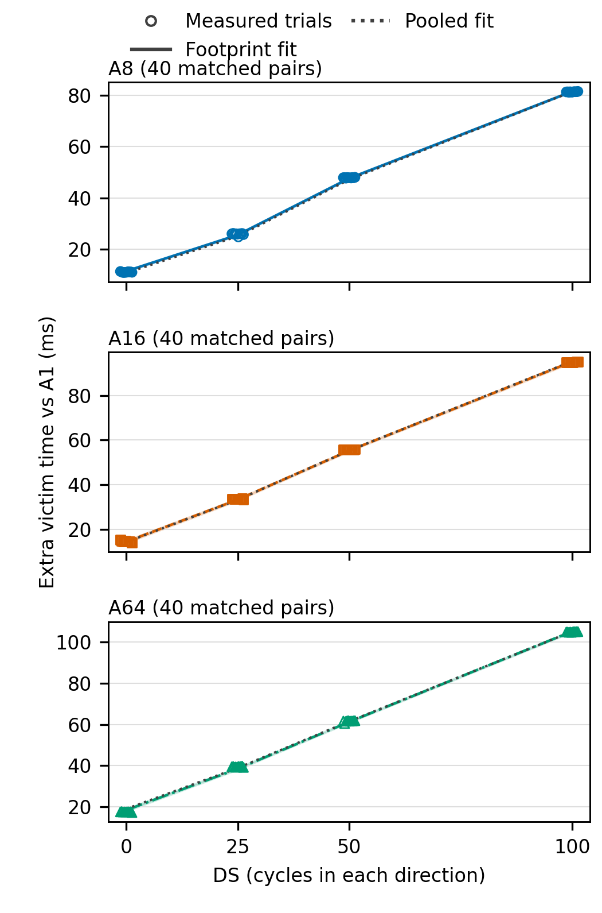
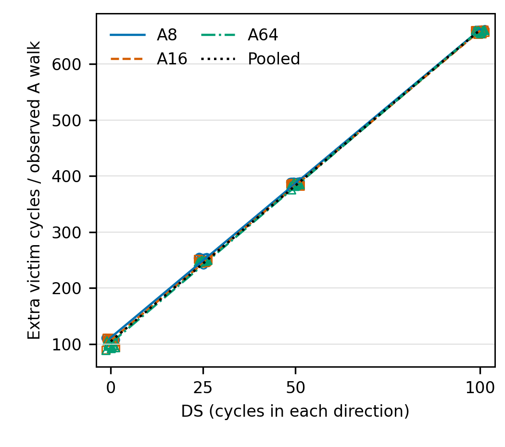

# DS 曲线的干扰定量模型：源码约束、拟合与条件验证

日期：2026-10-18。ARS experiment-agent / validate；离线分析。原始 CSV、记录、RTL、构建与加载报告只读；没有上板、构建或仿真。

合并模型得到 **t0=105.022 cycles/walk，k=5.56094，表观 η=0.92682，95% bootstrap CI [0.92219, 0.93165]**。三层 PTE 读支持边际参照值 2L=6，但 HPM 与硬件窗不一致，因此 η 不是已辨识的真实阻塞比例。模型刻画了主要增长趋势，不能声称精确解释全部增量。

## 1. 输入、单位与配对

输入为 [board_results.csv](../data/board_results.csv) 的 `board_baseline100` / `board_ds_sweep`、`statistic=sample`，共 200 次成功试次；不是用汇总中位数回归。DS0/25/50/100 × Solo/A1/A8/A16/A64 各 10 次；同 DS、boot、block、BIT、kernel、run 的 Ak 与 A1 配对。40 个完整块产生 120 个差值，每个足迹 40 对；Solo 用于保留原始设计身份，不进入此差分模型。所有试次保留。

定义 `y = T_V(Ak,DS) - T_V(A1,DS)`，T 是 V 硬件窗周期；`Nsw = aggressor_s1_ptw` 是 A 的**非原子软件快照差值**，不是硬件窗 walk 计数。A1 的 A S1 计数全部为零。受害者软件 S1 计数分布为 {'0': 168, '2': 32}；其中 DS0 的全部 30 个 Ak 试次均为 2，另有两次正 DS 试次为 2。不能把全部 Ak 称为严格 V 零 miss。

CSV SHA256：`bc5f46b99ccfc8ac048e59ef95e6e15554e985c65ca6612f140796de5e605308`。逐试次 row_id、原始 JSON pointer、A1 控制行及三种模型的预测/残差保存在 [samples.csv](interference-model-samples.csv)；全部试次身份见 [trials.csv](interference-model-trials.csv)。采集命令参数、固定源码 commit、四档文件哈希和原文摘录见 [RTL 证据](interference-model-rtl.json)。DS 档位允许使用对应的四个 BIT，禁止同一 DS 混用 BIT/kernel；本模型相关关键 RTL 的差别限于已核对的 DS 参数。实际加载身份与最终时序资格沿用 [时序审计](../related/timing-audit.md)。

Bootstrap 在 DS × boot 内抽取**整块**，保留三个 Ak 共用 A1 的相关性；10,000 次，PCG64，种子 20261018，线性百分位 95% CI。DS50 两个 boot 各 5 块，分别重抽，再合并描述同一配置；不是把两 boot 当成单 boot，也不是独立启动总体的 CI。DS0/25/100 各只有一个 boot；DS 与启动/采集顺序存在混杂。

| DS | boot_id | 块数 |
| --- | --- | ---: |
| 0 | `a816f6c1-b928-4801-98ea-9a55296159a7` | 10 |
| 25 | `0a1ae461-d2a5-4b43-8580-4544f313e058` | 10 |
| 50 | `9e98d41b-3475-4f5c-b825-ecac880eb8d2` | 5 |
| 50 | `b1eaa85f-01d7-4976-9dac-b57cc8af49b7` | 5 |
| 100 | `5cc1560a-b07e-4956-b1f2-e95e3cced13b` | 10 |

## 2. 从真实构建源码确定 L 与 DS 的作用

固定 CVA6 `8aac3fcd345af7686a55af1867783fd6b91a0069`、IOMMU `85b157ebe71a623e326e51fff7b7126fe77e8eb9`、Linux `45bf76b15e36cf608dff95013d91f8bedb7b1b8e`，入口是 [source-manifest.json](../board/manifests/source-manifest.json)。核对的是实际编译的冻结副本，而非当前开发分支。下述 `id` 对应 RTL 证据 JSON 的 `evidence[].id`，内含完整路径、精确行号、摘录和 SHA256。

| 问题 | 源码结论 | 可导航证据 id / 核心位置 |
| --- | --- | --- |
| 本负载的叶子大小 | 驱动逐 4KiB 映射，Sv39、S2 Bare；不是 2MiB 叶 | `MAP-4K-loop`/`MAP-4K-call`，idma.c:202/313；`MAP-mode`/`MAP-S2-default` |
| 每 walk 的读数 | 根→中间→末级，成功遍历 **L=3**；每层 ARLEN=0、ARSIZE=3，即单拍 8B PTE 读；串行等待上层响应 | `L-root`/`L-read`/`L-serial`/`L-next-middle`/`L-next-leaf`/`L-leaf`，rv_iommu_ptw.sv:258/313/382/415/506/541 |
| PTE 是否写回 | Linux 预置 A/D；此 PTW 的 AW/W valid 恒零；A/D 缺失报错，不能多算 A/D 写访存 | `MAP-ad`，io_pgtable.c:150；`AD-fault`，rv_iommu_ptw.sv:483 |
| 目录是否命中 | DDTC 8 项，只有 DID10/11；256 次预热且测量前排空，无测量内映射/失效。稳态 DDTC 命中是源码支持的条件预期，未逐试次测得 | `CACHE-size`/`CACHE-DDTC`/`CACHE-inval`/`CACHE-warmup` |
| PDTC | DMA conf/PV 为零，normal DC 不置 PDTV；本负载**绕过 PDTC**，不能称其 warm hit | `CACHE-conf-zero`/`CACHE-pv`/`CACHE-pv-wire`/`CACHE-PDTC-bypass`/`MAP-PDTV` |
| DS 放在哪里 | DS 总口 AR/AW/W 走输入延迟、R/B 走输出延迟；每个 PTE 的 AR 和 R 各经过一次 | `DS-place`，ariane_peripherals_xilinx.sv:1093；`DS-AR`/`DS-R`，axi_delayer.sv:60/112 |
| 一次 HPM 事件 | S1_PTW 为 event7，PT miss 信号经边沿门控只计一次，非每 PTE 或每 stall 周期一次 | `W-etype`/`W-pulse-source`/`W-single-edge`/`W-increment` |

没有中间 PTE 缓存将上述三次访问省略。冷 DDTC 的 DC 读为另一个 8-beat burst；其他 DS 客户端也共享延迟口，不能把所有 DS 流量都等同于 `3×Nsw`。本推导要求成功普通请求、S1-only、4KiB 末级叶、目录稳态且没有外部失效；不适用于嵌套翻译、超级页、异常、冷目录或设备上下文抖动。

还有一个必须披露的实现项：DS0 直接旁路；实际编译的是 CVA6 根 `vendor/pulp-platform/common_cells/src/stream_delay.sv`，不是 IOMMU vendor 下同名副本。其 Idle 装载 d，Valid 倒数到零后进入 Ready；d>1 时从首次输入 VALID 到释放 VALID 为 **d+2** 拍，d=1 另有特判。因此测得的正档 25/50/100，在理想 ready、每次从 Idle 开始时，每 walk 延迟器增加 `6d+12`；正档间边际仍为 `6Δd`。这不是对全部排队情形的精确全窗时长断言。证据：`COMPILE-resolve`/`DS-0`/`DS-FSM`/`DS-load`/`DS-count`。

## 3. 最小二乘、区间与残差

主模型 `y_i = Nsw_i × (t0 + k×DS_i) + e_i`，设计矩阵 `[Nsw, Nsw×DS]`；最小化**周期域**残差平方和，不额外添加常数截距。t0 是相对 A1 的有效每计数 walk 代价，不是单独测量的 PTW 服务延迟。η_app=k/6 仅是条件斜率比。表中参数为估计值 [95% CI]，R² 使用中心化总平方和；RMSE 和相对误差均针对 ΔT。

| 拟合 | t0 (cycles/walk) | k (cycles/walk/DS) | η_app | R² | RMSE (cycles) | 最大逐试次 ΔT 误差 |
| --- | --- | --- | --- | ---: | ---: | ---: |
| A8 | 111.738 [110.618, 112.603] | 5.501 [5.491, 5.513] | 0.917 [0.915, 0.919] | 0.999832 | 17110 | 4.60% |
| A16 | 106.260 [102.868, 109.458] | 5.534 [5.488, 5.582] | 0.922 [0.915, 0.930] | 0.999402 | 36469 | 18.13% |
| A64 | 101.696 [99.304, 104.292] | 5.598 [5.561, 5.631] | 0.933 [0.927, 0.939] | 0.999108 | 48318 | 14.66% |
| pooled | 105.022 [102.934, 107.018] | 5.561 [5.533, 5.590] | 0.927 [0.922, 0.932] | 0.999273 | 40734 | 18.41% |

合并模型的完整 V 时间最大误差只有 2.59%，但对应 ΔT 最大误差为 18.41%；较大的 A1 基线掩盖了部分增量误差。不能用接近 1 的 R² 或完整时间误差替代增量验证。DS0 的 per-walk 代价有足迹相关性与离散，不支持逐点严格相同的 t0；全部有符号逐试次残差均已导出，没有删除偏离点。

归一化 OLS `y/Nsw ~ 1+DS` 是另一种权重（对应周期域 1/Nsw²），合并结果 t0=107.117、k=5.53796；完整区间及逐足迹结果见 results.json 的 `per_walk_normalized_sensitivity`。它是敏感性分析，不取代预先说明的周期域目标。

机制修正敏感性模型为 `y=Nsw×[t0+k×(DS+2×I(DS>0))]`，仍只有两个参数；该固定阶跃由 RTL 提出，不是另外拟合的自由阶跃：

| 拟合 | t0 [95% CI] | k [95% CI] | η_app [95% CI] | ΔT RMSE (cycles) | 最大逐试次 ΔT 误差 |
| --- | --- | --- | --- | ---: | ---: |
| A8 | 107.073 [105.956, 107.938] | 5.421 [5.411, 5.433] | 0.904 [0.902, 0.905] | 11889 | 4.98% |
| A16 | 102.061 [98.875, 105.103] | 5.446 [5.403, 5.490] | 0.908 [0.900, 0.915] | 30693 | 13.46% |
| A64 | 97.915 [95.636, 100.384] | 5.501 [5.468, 5.533] | 0.917 [0.911, 0.922] | 31682 | 10.40% |
| pooled | 100.933 [98.972, 102.828] | 5.471 [5.445, 5.498] | 0.912 [0.907, 0.916] | 31406 | 13.80% |

修正改善整体残差，但仍有足迹依赖、DS0 偏差和非同窗计数误差，不能称为已经完整辨识硬件阻塞机制。三种估计及联合参数 bootstrap 协方差保存在 [results.json](interference-model-results.json)。

## 4. 留一验证：整格留出，不在重复样本间泄漏

“点”定义为一个 DS×足迹格，留出其全部 10 次重复。逐足迹模型以其他三个 DS 格拟合；合并模型以其他 11 格拟合。另做更严格的整 DS 留出，一次排除该 DS 的三个足迹共 30 次。表中均值与逐试次最大误差由留出预测计算；误差分母是各自实测 ΔT，不是完整 V 时间。

| 留出足迹 | DS | 实测 ΔT 均值 (cycles) | 逐足迹预测均值 (cycles) | 逐足迹最大误差 | 合并整格最大误差 |
| --- | ---: | ---: | ---: | ---: | ---: |
| A8 | 0 | 556975.2 | 597422.6 | 8.78% | 5.58% |
| A8 | 25 | 1294939.9 | 1275616.3 | 2.80% | 4.52% |
| A8 | 50 | 2394807.3 | 2377682.5 | 1.03% | 1.88% |
| A8 | 100 | 4066812.8 | 4123636.1 | 1.57% | 0.30% |
| A16 | 0 | 734846.0 | 795277.8 | 24.31% | 17.39% |
| A16 | 25 | 1682931.2 | 1652426.2 | 3.35% | 3.22% |
| A16 | 50 | 2788090.1 | 2762145.3 | 1.47% | 1.27% |
| A16 | 100 | 4742948.0 | 4828381.6 | 2.45% | 1.37% |
| A64 | 0 | 874548.7 | 999782.9 | 25.20% | 22.78% |
| A64 | 25 | 1972186.9 | 1899808.0 | 4.25% | 2.54% |
| A64 | 50 | 3078542.2 | 3051116.0 | 1.94% | 2.02% |
| A64 | 100 | 5248178.1 | 5376446.9 | 3.12% | 1.27% |

| 合并模型整 DS 留出 | 实测 ΔT 均值 (cycles) | 预测均值 (cycles) | ΔT 相对 RMSE | 最大 ΔT 误差 | 修正模型最大 ΔT 误差 |
| --- | ---: | ---: | ---: | ---: | ---: |
| DS0 | 722123.3 | 796111.0 | 12.13% | 26.69% | 14.36% |
| DS25 | 1650019.3 | 1604421.0 | 3.11% | 5.08% | 2.96% |
| DS50 | 2753813.2 | 2726213.4 | 1.33% | 2.02% | 2.64% |
| DS100 | 4685979.6 | 4784506.4 | 2.12% | 2.93% | 0.99% |

| 全部留出预测汇总 | 主模型 ΔT 相对 RMSE / 最大误差 | 主模型完整 TV 最大误差 | 修正模型 ΔT 相对 RMSE / 最大误差 |
| --- | --- | ---: | --- |
| 逐足迹整格 | 6.23% / 25.20% | 3.54% | 3.09% / 12.86% |
| 合并整格 | 4.87% / 22.78% | 3.20% | 4.03% / 16.05% |
| 合并整 DS | 6.38% / 26.69% | 3.75% | 3.62% / 14.36% |

留出预测仍使用被留出试次**实测的 Nsw**，重建完整 TV 时也使用其同块实测 A1。因此这是**条件验证**，不是实验前盲预测；walk 数会随 DS 和 V 完成时间变化，是内生协变量。合并整格还保留该 DS 的其他足迹和共享 A1，仅整 DS 留出才检查未见 DS。不能把完整时间误差较小解释为已经能够预测新负载。逐点预测、训练/测试身份及三模型结果见 [loo.csv](interference-model-loo.csv)、[loo-samples.csv](interference-model-loo-samples.csv) 和 results.json 的 `leave_out`。

## 5. HPM 非原子窗口：可证明的范围与未识别误差

冻结驱动 `iommu-hpm.c:185` 依次读取 cycle、V miss/S1/S2、A miss/S1/S2；每个 64-bit counter 的 hi/lo/hi 读取防撕裂，但没有全计数器共同锁存。`idma.c:945` 在 A/V 启动前读 before；`idma_batch_window:576` 先启动 A 再启动 V；V 完成后 CPU 轮询发现、停止 A，再读 after，最后才排空 A。因此计数窗口覆盖 V 硬件窗前后的时段，Nsw 可能多计这些时段的事件；不能仅因存在额外时长就断言必有额外 walk。

对**实际登记的 HPM 增量**，在单调且未溢出的正常计数和有序 MMIO 前提下，可给出的保守包含界是 `0 ≤ N_HPM,in-V ≤ Nsw`，窗外多计在 `[0,Nsw]`。它不是有用的窄误差条；把计数再对应到真实 PTW 启动事件还需考虑事件登记延迟/校准。缺少逐事件硬件时间戳，不能声称“最多 ±1/±2 walk”，也不能把 η 的窄 bootstrap CI 当作这项系统误差的范围。若窗外比例随 DS 改变，η_app 连单纯比例校正都不成立。

`Tsw-20×Thw` 是软件区间相对硬件窗的时间余量（ns），HPM 读点覆盖额外 before/after 的一部分；由保存的 aggregate 时长得到保守时间区间 `[Tsw-20Thw, Tsw-20Thw+snapshot_before+snapshot_after]`。这只约束时长，不约束期间 walk 的速率。示例 A8 的中位数如下（毫秒）；全部范围保存在 [observers.json](interference-model-observers.json)。

| DS | Tsw−Thw 中位数 (ms) | before 快照时长中位数 (ms) | after 时长中位数 (ms) |
| --- | ---: | ---: | ---: |
| 0 | 3.224 | 0.074 | 0.240 |
| 25 | 18.973 | 0.074 | 0.241 |
| 50 | 18.151 | 0.074 | 0.242 |
| 100 | 1.273 | 0.074 | 0.223 |

不能用 A 全程 completed copies 减去 V 窗内字节，直接求出额外 walk：边界存在在途请求，每 copy 的 miss 数也不是常数，V 停止后缓存状态还会改变。helper 中 `Nsw±1/±2` 仅是标注为假设的敏感性字段，不是测得误差界。本分析不以该字段修正样本。

## 6. 第二条证据：V 内部读路径

path_vr1 以硬件记录的进入握手到内部输出首次 VALID 度量，包括翻译、排队与缓冲的驻留，不是纯 PTW 服务时间。每试次 read/write 各 8192 个 burst，全部 path 阶段 full=entered=8192、start/carry/end=0、area=sum。下表先逐块 Ak−A1，再取中位数，单位 cycles/burst：

| 足迹 | DS0 Δvr1 | DS25 Δvr1 | DS50 Δvr1 | DS100 Δvr1 |
| --- | ---: | ---: | ---: | ---: |
| A8 | 117.50 | 310.39 | 575.91 | 986.14 |
| A16 | 161.57 | 401.74 | 670.46 | 1149.63 |
| A64 | 197.65 | 470.41 | 742.00 | 1271.64 |

所有足迹的内部读驻留随 DS 增长，与 ΔT 的增长方向一致。正 DS 下 `8192×Δvr1/ΔTV` 的逐试次比值中位数约从 1.95 增到 1.99，说明该路径也随整窗代价增长；它同时表明不能把每 burst 驻留总和当作 elapsed time：多个在途 burst 的等待发生重叠。路径与 HPM 是不同观测机制，但共享同次运行/boot；这提供趋势佐证，不能独立校准 η 或精确归因所有周期。

## 7. 明确标为外推：每次 PTE 访存增加 50/100/200 ns

主解释将该 ns 数定义为**一次 PTE 读的总往返额外时间**。平台 50MHz，每拍 20ns；由于诊断 DS 在请求、响应各加一次，等价名义 DS 为 `τ/(2×20)=1.25/2.5/5`，不是 2.5/5/10。若 τ 指每个方向单独增加，后者才成立，CSV 已另列。

物理内存情景保持 DS0 的逐块 Nsw 和 A1 不变，边际额外干扰为 `δT = Nsw_DS0 × k × τ/40`。以下使用合并主模型，表示**相对实测 DS0 的新增量**；不是已有总干扰或完整 TV。未把诊断延迟器的 +2 拍启动阶跃加入真实内存延迟。主模型参数 CI 不覆盖固定 Nsw 或物理系统外推的系统误差。

| 每 PTE 总往返增加 | 等价 DS/方向 | 每计数 walk 新增 (cycles) | A8 新增 V 时间 (ms) | A16 新增 (ms) | A64 新增 (ms) |
| --- | ---: | ---: | ---: | ---: | ---: |
| 50 ns | 1.25 | 6.951 | 0.715 | 0.952 | 1.255 |
| 100 ns | 2.5 | 13.902 | 1.429 | 1.904 | 2.509 |
| 200 ns | 5 | 27.805 | 2.859 | 3.808 | 5.018 |

逐足迹/合并、主/归一化/机制修正的参数条件区间、以模型 DS0 或实测 DS0 锚定的总 ΔT 与完整 TV，均在 [projections.csv](interference-model-projections.csv)。`physical_memory_increment` 与 `diagnostic_ds_configuration` 明确分列；后者包括诊断器实现项，不可冒充真实内存延迟。

这是**物理场景外推**：等价延迟数值位于已测 DS 范围内，但小数 DS 不是实际 RTL 档位，且未测真实内存技术。前提包括 walk 层数/缓存状态、walk 数、A 供给、V 基线、时钟、并发程度与仲裁规律均不变，额外延迟能映射为相同串行 PTE 路径暴露；不包含带宽/服务时间分布、并行度或协议的改变。若这些前提变化，不给出无条件应用级慢化预测。

## 8. 模型成立的条件 / 不成立的条件

**模型成立的条件**：限定本次相同基座、负载与启动样本，用实测 Nsw 作为条件输入时，三层串行 PTE 与双向 DS 延迟提供机制依据；约 5.5 的边际斜率和内部路径增长支持一阶经验近似。它可用于组织敏感性结果、给出条件估算和检查大偏差。

**模型不成立的条件**：严格的共同 t0/k 精确公式没有覆盖全部点；DS0 留出有结构偏差。DS0 直接旁路使名义 DS 原模型漏掉正档 FSM 阶跃。Nsw 与 V 硬件窗未对齐、V 偶发软件计数不为零、Nsw 内生、DS 与 boot 混杂，均妨碍把 η_app 解释为真实阻塞份额或因果常数。超级页/嵌套翻译/冷目录/不同供给与并发/不同内存体系需要重新校准，不能沿用 L=3 与当前误差保证。

按 ARS validate 作 **11/11** 统计/方法谬误检查：Simpson（逐足迹与合并同向，但参数非完全相同）；生态谬误（不从整窗拟合推单请求精确延迟）；Berkson（仅已接受的固定成功矩阵，外推限于此）；collider（Nsw 内生，条件拟合不作因果控制）；base-rate（非分类诊断，不适用）；回归均值（未按极端值选点）；幸存者（200/200 输入全保留，不推失败运行）；多重搜寻（无显著性检验，不选报 p 值）；分析分叉（探索性模型，三种规格全部保留）；相关即因果（源码机制与经验吻合分开，不称因果识别）；反向因果（V 持续更久也使 A 能执行更多 walk，明确披露）。结论等级为 CAUTION：有机制支持的条件模型，不是无条件硬件定律。

## 9. 图表与复现



图 1：120 个配对试次，分别显示逐足迹与合并主模型；浅色区是参数条件 CI，不是新试次预测区间。横向微小抖动仅为避免点重叠，真实 DS 仍为四档。



图 2：ΔT/Nsw 与 DS；线仍来自周期域主拟合，避免暗中改成归一化目标。两图均 3.5 英寸宽、8pt，颜色加线型/符号区别，PDF 与 PNG 同步保存。PDF：[实测对照](figures/interference-model-measured-predicted.pdf)、[每 walk 代价](figures/interference-model-per-walk.pdf)。

在仓库根运行（Python 3，numpy、matplotlib；无下载/硬件操作）：

```bash
python3 paper/ispass2027/analysis/scripts/interference_model.py --levels 3 --levels-status confirmed --self-test
python3 paper/ispass2027/analysis/scripts/interference_model_observers.py
python3 paper/ispass2027/analysis/scripts/interference_model_rtl_verify.py
python3 paper/ispass2027/analysis/scripts/interference_model_report.py
```

稀疏 worktree 中 observer/RTL 核查可加 `--source-root /home/xvhaocheng/work` 读取原始保存副本；模型脚本默认读取自身所属 worktree 的 CSV。RTL 原冻结目录不随小型分析包复制，缺失时 verifier 会报缺失，不据此宣称原文已重新核验。上述依赖的实际版本、输入 SHA、固定随机数参数和输出 SHA 在 results.json 中记录；数值输出可复现，绝对路径/运行时版本字段可能随环境变化。

[validation.json](interference-model-validation.json) 记录本轮接受检查：真实数值原始 pointer 回查、独立高精度闭式 OLS、bootstrap 数值对照、整格/整 DS 训练泄漏与身份负例、输入未改、实际 PDF 字体/尺寸核查。它是本轮检查记录，不是额外板测。源码证据的全量复核由 rtl_verify 脚本执行；完整 HPM/path 边界算术由 observer 脚本重建。所有论文可用数字及分析结果单独保存，没有改历史数据或报告。

<!-- INTERFERENCE_MODEL_APPENDICES -->

## 10. 追加审计：现有 observer 能否提供同硬件窗的遍历次数

2026-10-18，ARS experiment-agent / validate；Verification Status: ANALYZED。**结论：主模型所用统一 DS0/25/50/100 的 200 次试次，没有采集 V 硬件窗内的 DS AR 握手计数，也没有采集按 A 归属的 S1/PTW 启动计数。** `shared_ar`、`shared_ar_wait`、`a_ar`、`a_aw` 和 path 计数均不能替换 Nsw。因此本轮没有硬件窗分母的新拟合、bootstrap 或留出结果；主模型与 d+2 修正模型的原有结果保留。

本节只追加，不改动上文。审计从[逐实验总账的统一基线和 DS 扩展](../../../docs/experiment-ledger/README.md)定位实际 source/build manifest，再重新核读冻结 RTL 与字段导出链；不是从名字或旧摘要推断。完整路径、行号、原文、源 SHA256、全部字段库存与读取验证见 [observer 审计证据](interference-model-observer-audit.json)。结论限于这 200 个同基座试次；全表另有历史 `a_miss/a_lookup` 等字段，在本矩阵没有逐试次值，不能跨 BIT/版本补成四档模型的分母。

### 10.1 真实接线与计数单位

以实际冻结目录 `iommu-platform/out/ispass2027-20261017-ds0-01/src/cva6/corev_apu/fpga/src/` 为下表路径前缀。三份关键文件（peripherals、observer、path observer）在四档构建中共 12 项逐字节核对，均匹配相应真实 build manifest 的 `sources` 与固定 source overlay。

| CSV / 原始字段 | 槽位与真实 RTL 定义 | 为何不能作为 DS/PTE 或遍历次数 |
| --- | --- | --- |
| `a_ar`、`a_aw` | slot20/21；`active && axi_dma_tr[aggressor].ARVALID && ARREADY`，AW 同理；peripherals:912–917，dma_observer.sv:178–179 | DMA mux **之前**的 A 数据请求握手；命中和 miss 都经过，不是 PTE 读/写 |
| `a_ar_wait`、`a_aw_wait` | slot24/25；同一私有口 `active && VALID && !READY`；observer:182–183 | 逐周期入口反压；一个请求可贡献多个周期，不是事件次数 |
| `shared_ar`、`shared_aw` | slot26/27；`active && axi_iommu_tr_req.ar_valid && axi_iommu_tr_resp.ar_ready`；peripherals:936–939，observer:186–187 | DMA mux **之后**、IOMMU **未翻译 TR 入口**的合并握手，包含 V 和 A；DS 端口不在此处 |
| `shared_ar_wait`、`shared_aw_wait` | slot28/29；同一 TR 口 `active && VALID && !READY`；observer:188–189 | TR 入口停顿周期，不是 DS AR 接受数，也不是 PTW 启动 |
| `a_rlast/a_b`、`v_rlast/v_b`，`a_start/a_end` 等 | 数据通路响应及各私有 TR 口在途库存；observer:123–145、175–188、201–202 | 描述数据 burst 的完成/跨窗状态，不能给出 PTW 的启动或跨窗库存 |
| path stage0–3 的 `entered/full/carry/start/end/sum/area` 与 CSV 派生 mean/max | 私有 TR 首 VALID → 合并 TR 握手 → COMP 首 VALID → COMP 握手 → COMP RLAST/B；peripherals:940–946，dma_path_observer.sv:132–136 | 全链只看 TR/COMP 数据请求；内部阶段时长可受翻译影响，但没有暴露 PTW 启动点或 PTE AR 事件 |

真正的 `axi_iommu_ds_req/resp` 在 peripherals:1093–1128 独立连接 DS delayer/直连分支，在 :1178–1179 接 IOMMU DS 口；observer 实例 :924–947 没有连接该信号，也没有 PTW/HPM 事件输入。核查了完整 observer/path 端口列表与所有基础计数槽，不存在未被 CSV 名字显露的 DS 计数。

导出链也没有将 DS 数藏在 `shared` 中：冻结驱动 `drivers/misc/idma.c:754–756` 依槽读寄存器，:828–832 将 slot20–29 打印在同一 `part=axi_a` 行；collector 将其保存为 `/i/observer/axi_a/shared_ar` 等。因此 raw JSON 的 `axi_a` 对象中含共享 TR 字段，**不代表这些共享字段只统计 A，或统计了 DS**。对 200 份既有命令输出的纯解析函数离线重放，与保存的 record/observer/path/metrics 一致；未打开 UART 或触发硬件。

### 10.2 同窗是必要条件，信号语义也必须相同

这些基础计数确实与 `hardware_cycles` 同门控：`active=(phase_q==HARDWARE || POLL_WAIT || REFILL)`；开窗首个 V issue 边沿旧状态为 ARMED，不加这些计数，目标最终 done 边沿仍 active，先计数再进入 BATCH_READ。端点为 **(首 issue，最终 done]**，包含批次内补给间隔，排除之后的软件完成发现时间。证据：observer:70、148–154、171–201。path 同样使用 active；它另保留跨窗 scoreboard，不能把其 carry 当作 PTW carry。

逐试次事实与源码定义一致：全部 160 次共跑 `a_ar=a_aw=8192`、`shared_ar=shared_aw=16384`；40 次 Solo 的对应值分别为 0 和 8192；上述 private/shared 的 AR/AW wait 在 200 次中均为 0。DS0/A1 的 10 次 A S1 软件计数全部为 0，但其 `a_ar` 仍为 8192、`shared_ar` 仍为 16384。一个具体可追溯例子为 `board_baseline100.baseline100-20261017-01.ds0-middle-69005cc2.case0002`：`/1/record/result/aggressor/s1_ptw=0`，`/1/observer/axi_a/ar=8192`，`/1/observer/axi_a/shared_ar=16384`。不能把这些数据请求数除以 L=3，制造硬件窗遍历数。

即使未来只新增整个 DS 口的 AR 计数，也不能无条件 `/3`：DS 读仲裁器还合并 DDTW、PDTW、CQ、PQ、MSIPTW、MRIF 等客户端（`rv_iommu_ds_if.sv:77–110`）；未带 owner DID 的 PTW AR 还混合 V 与 A。即便已过滤为 A 的成功三层 PTE 读，窗口仍可能切开三次读：`R_HW = 3×N_start,HW + B_pre − B_post`，其中 B_pre 是窗前启动、在窗内发出的 PTE 读，B_post 是窗内启动、在窗后发出的 PTE 读。原 observer 的 start/end 是 **DMA 数据请求**库存，无法求这两个 PTW 边界项。

### 10.3 重拟合可用性与原结果对照

下表只是上文结果的引用，**不是新拟合**；误差口径仍为“合并模型整档 DS 留出”的最大逐试次 ΔT 相对误差。硬件窗分母缺失，无法比较替代后参数的变化，也不能断言修正后的 k 或 η 必然增大或减小。

| 模型 | 原 Nsw 的 t0 | 原 Nsw 的 k | 原 η_app | 原整 DS 留出最大误差 | 换成 N_HW 的结果 |
| --- | ---: | ---: | ---: | ---: | --- |
| 主模型 | 105.021857 | 5.560939 | 0.926823 | 26.69% | N/A：未观测 |
| d+2 修正模型 | 100.933488 | 5.470568 | 0.911761 | 14.36% | N/A：未观测 |

### 10.4 最小计数器方案（仅方案，未实施）

缺少的首选信号是 **A 的 S1 walk 实际接受启动脉冲，以及该 walk 的 owner DID**。`ptw_init=(state_q==PT)&&!iotlb_lu_hit` 在等待中保持为高，不能每拍累加；应取 PTW 的真实接受条件 `state_q==IDLE && init_ptw_i && !edge_trigger_q`，并限定 `en_1S_i && !imp_init_i`。源码位置：`rv_iommu_ptw.sv:149–155/313–325`；owner 来自 TL 的 `req_data.did`（`rv_iommu_tl_wrap.sv:766`），在启动接受时锁定/关联。本负载 A 为 DID11，不能用 DS ARID0 代替 DID。

最小主量是一只 64 位 `a_s1_start_in_v` 计数器：ARM 清零；`active && accepted_s1_start && owner_did==armed_A_DID` 时加一；使用与现有周期计数相同的窗口边沿，在最终 done 边沿计完后冻结。复用 sticky overflow/error、冻结后读回和明确升级的 observer 版本/字段有效性；旧 v3 的缺字段必须保持缺失，不能读作零。实际启动周期与 HPM 注册增量周期有流水差，应选前者并写明，不把两个时刻混用。

为保留最低限度的边界诊断，再保存开窗/关窗时 A S1 walk 在途标志及 owner；这些状态需持续跟踪，**不因 ARM/open 重置启动边沿跟踪器**。若需要区分边界部分遍历的服务量，可另存当时层级；可选增加 V 的同窗启动计数，以判断当前 V 软件计数为 2 的试次在硬件窗内是否实际启动过遍历。可选的 PTW 专用 AR 计数须指定 delayer 前/后取点、过滤客户端并沿握手携带 owner，作为读数核账；它不是最小启动计数的替代品。

这只会改善分母与硬件窗对齐；V 窗持续时间与 A walk 数的内生关系、边界残余服务和重叠仍需建模，不能预先保证 η 变成真实阻塞概率。以上仅为未来的被动计数接口方案：本轮没有实施 RTL/驱动、构建 BIT、仿真或上板，也没有把缺失事件反推为新数据。上文 11/11 方法谬误检查保持；本节未新增显著性检验或选择性模型比较。

原 CSV、已有数值 JSON/CSV、图与源码取证文件保持原字节；原报告前 19727 字节 SHA256 为 `73fb8ffdf6443644bfd15a2fffe1726556eba7aa970c21d6b970c7c9645d609b`。报告生成器仅增加保留此追加节的逻辑，避免日后重建 §1–9 时丢失审计；没有改变拟合算法或旧数值。
